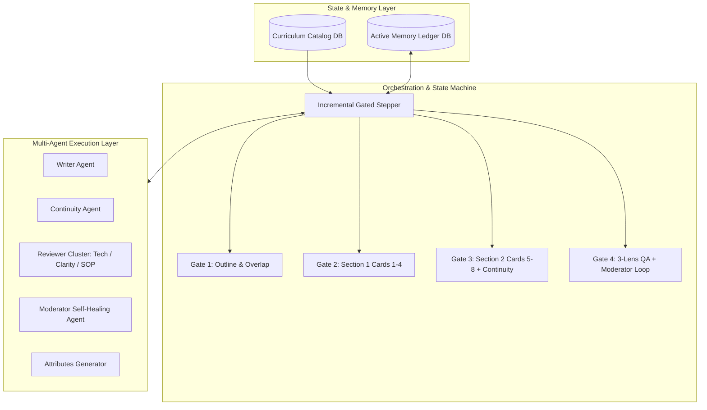
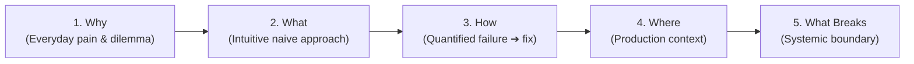

# Complete Master Specification Document: Multi-Agent AI Script Generation & Quality Governance Platform
**Product:** Scaler Curriculum Script Creation & Editorial Platform  
**Target Curriculum Taxonomy:** Program $\to$ Track $\to$ Module $\to$ Class  
**Alignment:** 100% Aligned with Product Requirements Document (PRD FR-1 to FR-23) & Good Script Rules  

---

## 1. Executive Summary & Problem Framing

### 1.1 What is This Platform?
The **Script Creation & Content Authoring Platform** is an AI-powered, multi-agent editorial system designed specifically for technical education. Rather than treating technical lectures as monolithic essays, the platform structures lecture authoring as an **incremental, gated card-deck authoring pipeline** governed by a strict curriculum graph (`Program -> Track -> Module -> Class`).

### 1.2 Core Problems Solved
| Legacy Pain Point | Root Cause in Previous Tool | Platform Solution Delivered |
| :--- | :--- | :--- |
| **High Turnaround Time (TAT)** | SMEs spend hours manually drafting scripts from scratch. | AI Writer proposes structured outlines and section cards in minutes, shifting the SME from *author* to *editor/reviewer*. |
| **Bloated, Unteachable Scripts** | LLMs produce 8,000-word narrative essays unsuitable for live classes. | Strict **Card Token & Brevity Engine**: 14–18 cards per 90-min lecture (~250–400 words/card, 2–4 sentences/paragraph). |
| **Context Amnesia & Topic Bleed** | Classes drafted in silos without continuity; topics bleed between lectures. | **Automated Database Memory Engine** retrieves prior GTG concepts and strictly locks upcoming class boundaries. |
| **Technical Dialect Traps** | Hallucinated syntax; mixing BigQuery vs. MySQL; unbound table names. | Dialect-aware linting (BigQuery dataset prefixes vs. MySQL 8.0) bound to verified 100KB test datasets (`CampusBites`). |
| **Cognitive Analogy Whiplash** | Switching analogies mid-lecture (library $\to$ bank $\to$ gate) confuses learners. | **Single Running Domain**: Anchored to one relatable daily-life domain (`CampusBites` canteen) throughout the entire class and module. |
| **No "Why" & Missing Pacing** | Scripts jumped straight into technical definitions with zero intuition. | **5-Step Socratic Shape**: Why $\to$ What $\to$ How $\to$ Where $\to$ What Breaks (Naive scale $\to$ Quantified failure $\to$ Name fix). |

---

## 2. PRD Traceability & Functional Requirements Matrix (FR-1 to FR-23)

| PRD Req ID | PRD Title & Requirement Description | System Implementation in Platform |
| :--- | :--- | :--- |
| **FR-1** | **User Onboarding by Program & Track**<br>Every SME/Author and Program Manager is assigned to a program, and a track where applicable. | Role session binds the user to their permitted programs (Academy, DSML, AIML, DevOps) and tracks (Backend, Fullstack, SQL). |
| **FR-2** | **Scoped Access & Global PM Visibility**<br>People work only in programs they joined. Program Managers retain global read-only visibility. | SME/MO workspace filters by joined programs. Program Manager (LO Team) dashboard has cross-program velocity visibility. |
| **FR-3** | **Curriculum Syllabus Ingestion**<br>Modules and classes can be entered manually, parsed from syllabus documents (.pdf/.docx), or both. | Module Owner studio includes AI syllabus parser extracting class lists, agendas, prerequisites, and learning outcomes. |
| **FR-4** | **Module Plan Review & Gating**<br>Parsed or entered module plans go through a review step before being locked. | MO reviews extracted class list, tags modules, and explicitly triggers `[Lock Module Plan]` to unlock SME drafting. |
| **FR-5** | **Post-Lock Administrative Editing**<br>MOs and Admins can edit modules and class lists from the Admin end, even after locking. | Admin/MO overrides permit agenda adjustments, class re-sequencing, and syllabus revisions with automated versioning. |
| **FR-6** | **Mandatory Script Authoring Gate**<br>Script creation stays disabled until at least one complete module exists (Title, Agendas, Outcomes, Assigned SME). | Cascading dropdowns disable the `[Generate Script]` trigger unless the selected module meets all 4 completeness criteria. |
| **FR-7** | **Class Sequence & Status Tracking**<br>System tracks sequence of each module and program, marking each class as taught or upcoming. | Curriculum Graph tracks class index ($1..N$). State flags: `Taught` (locked memory), `Active Drafting`, `Upcoming` (locked boundary). |
| **FR-8** | **Automated Curriculum Context Memory**<br>Every draft queries the database of approved GTG scripts. Zero manual file uploads required. | Queries database on class selection. Auto-detects **Class 1 (Inaugural)** vs. **Classes $\ge$ 2 (Continuing)**, injecting active variables. |
| **FR-9** | **Cascading Dropdowns & Outline First**<br>SME selects Program $\to$ Track $\to$ Module $\to$ Class. AI proposes a class outline first. | 4-level cascading selector initializes configuration; AI Writer generates a 16-card structured outline before writing full text. |
| **FR-10** | **Overlap Audit & 3-Way Decisions**<br>Outline flags overlap with past and upcoming classes. Interactive 3-way gate: `[GTG]`, `[Edit]`, `[ReThink]`. | Overlap Engine audits past/future syllabi (e.g., flags `JOIN`s in Class 1). SME makes a 3-way decision at every milestone. |
| **FR-11** | **Inline AI Assist Copilot**<br>Inline AI assist is available while SME/Authors edit a script. | Dedicated editor toolbar with one-click actions: *Simplify Vocabulary*, *Inject Quantified Failure*, *Insert Chat Cues*. |
| **FR-11b** | **Incremental Section Authoring**<br>Scripts are drafted and approved section-by-section with live cross-section continuity auditing. | 4-stage stepper: Step 1 (Outline) $\to$ Step 2 (Cards 1–4) $\to$ Step 3 (Cards 5–8 + Continuity Audit) $\to$ Step 4 (Multi-Agent QA). |
| **FR-12** | **Pre-approved Official Documentation**<br>Module has approved docs bound by MO (e.g., BigQuery docs); AI may search web to fill gaps. | Sourced references partitioned into *Approved Documentation* vs. *Web Search Gap-Fill*. |
| **FR-13** | **Reference Provenance & Timestamps**<br>Each script lists the documentation it relied on, with URLs and retrieval timestamps. | Sourced Reference Ledger displays citation links, retrieval dates, and documentation version numbers. |
| **FR-14** | **SME Reference Validation Gate**<br>References found by web search outside the approved list are labelled for SME validation before use. | Authors must explicitly toggle `[Validate & Approve]` on external references before the Writer Agent can incorporate them. |
| **FR-15** | **Shareable Link from Creation**<br>Every script has a shareable permalink from creation; carries official GTG mark only after MO approval. | Permalink (`scaler.com/scripts/{slug}`) generated at initialization; official `[GTG]` certified badge added only upon MO approval. |
| **FR-16** | **Strict Status Lifecycle**<br>Not Started $\to$ Script WIP $\to$ SME Review $\to$ MO Approval $\to$ GTG. | Unidirectional state machine. SME review occurs after AI QA loop clears; MO approval is the final gating step. |
| **FR-17** | **Self-Healing Moderator QA Loop**<br>When a script fails an AI check, AI acts as moderator, fixes issues, and re-checks (max 2 times). | Autonomous Moderator Agent intercepts reviewer lens failures, patches text, and re-evaluates up to 2 iterations without halting author. |
| **FR-18** | **Class & Module Metadata Storage**<br>Records class type (Live, Inverted, Lab), module tag (Core, Elective, Specialisation), content change %. | Stored in script header: Type, Tag, Version, Dialect (`BigQuery`/`MySQL`), Bound Dataset, and Content Delta %. |
| **FR-19** | **Zero-Upload Memory Architecture**<br>Automated context inheritance replacing manual file uploads. | Database-backed ledger passes forward terms mastered, running example state, and prior cliffhanger to subsequent classes. |
| **FR-20** | **Attributes Generator (Media Assets)**<br>Scripts include animations, images, and Mermaid flow diagrams. | Dedicated agent produces HTML/CSS micro-animations, system architecture image previews, and live Mermaid diagrams ($\le 7$ nodes). |
| **FR-21** | **Human Chat Evaluation**<br>SME or MO can evaluate a created script in a chat-based interactive environment. | Live Teleprompter simulation view allows conversational verification of delivery pacing and two-way prompts. |
| **FR-22** | **Golden Dataset Benchmarking**<br>Golden datasets measure quality, readability, and delivery parameters. | Benchmark reference scripts (e.g., `Golden_Script_Example_Intro_DBMS.md`) calibrate scoring thresholds for reviewer lenses. |
| **FR-23** | **Assignments & Mock Interview Export (v2)**<br>Tool generates assignments documentation and mock interview questions based on industry asks. | Extensible schema reserving endpoints for post-class assignment rubrics and interview question generation. |

---

## 3. Engineering Implementation Strategy: How We Implement Each Component

### 3.1 Architectural Philosophy: Why This Strategy?
Monolithic, single-prompt generation fails in curriculum development because LLMs:
1. Experience **token dilution** and lose track of time budgeting across 90-minute scripts.
2. Suffer from **context amnesia** between classes if previous transcripts must be manually attached.
3. Switch analogies mid-stream to minimize perplexity rather than maintaining teaching consistency.

**Our Core Solution Strategy:**


---

### 3.2 Implementation of PRD Requirements Group-by-Group

#### Group A: Onboarding, Scoped Permissions & RBAC (FR-1, FR-2)
- **Implementation Strategy**:
  - User profiles store a structured JSON claim: `{ user_id, name, role: 'sme'|'mo'|'pm'|'admin', allowed_programs: ['academy', 'dsml'], allowed_tracks: ['backend', 'sql'] }`.
  - Frontend conditionally renders actions based on role (e.g., SME sees authoring controls; MO sees syllabus lock and GTG approval buttons).
  - Program Manager view runs a global aggregate query over all programs, rendering a read-only velocity dashboard without edit triggers.

#### Group B: Curriculum Ingestion, Locking & Completeness Gates (FR-3, FR-4, FR-5, FR-6)
- **Implementation Strategy**:
  - **Syllabus Parsing Pipeline**: File upload (`.pdf` or `.docx`) triggers a document parser that extracts text blocks and feeds them to an extraction prompt with a strict JSON schema:
    ```json
    {
      "module_id": "mod_sql_01",
      "module_title": "Database Architecture & SQL",
      "module_tag": "Core",
      "classes": [
        {
          "class_index": 1,
          "title": "Introduction to DBMS & Relational Modeling",
          "class_type": "Live",
          "target_duration_mins": 90,
          "agendas": ["Why files fail at scale", "Canteen concurrency bottleneck", "BigQuery basic SELECT"],
          "learning_outcomes": ["Understand OS file lock limits", "Read 3-line SQL queries in plain English"],
          "assigned_sme": "Ankit Mishra"
        }
      ]
    }
    ```
  - **FR-6 Completeness Gate**: In the UI, the `[Generate Script]` button is dynamically disabled until the selected class record verifies:
    $$\text{title} \neq \emptyset \;\land\; \text{len}(\text{agendas}) \ge 1 \;\land\; \text{len}(\text{outcomes}) \ge 1 \;\land\; \text{assigned\_sme} \neq \emptyset$$
  - **Module Lock**: When the MO clicks `[Lock Module Plan]`, the module record sets `is_locked: true`. This unlocks script authoring for assigned SMEs while preserving version history.

#### Group C: Automated Curriculum Context Memory & Zero-Upload Ledger (FR-7, FR-8, FR-18, FR-19)
- **Implementation Strategy**:
  - **Database Schema**:
    ```sql
    CREATE TABLE curriculum_memory_ledger (
      id UUID PRIMARY KEY,
      program_id VARCHAR(50),
      track_id VARCHAR(50),
      module_id VARCHAR(50),
      class_index INT,
      status VARCHAR(20), -- 'WIP', 'SME_REVIEW', 'MO_APPROVAL', 'GTG'
      running_domain VARCHAR(100), -- 'CampusBites'
      terms_mastered JSONB, -- ['database', 'file_lock', 'table', 'row', 'select', 'where']
      active_tables JSONB, -- [{'table': 'campusbites.orders', 'columns': ['order_id', 'student_name', 'amount']}]
      prior_cliffhanger TEXT, -- 'How do we fetch data from multiple tables simultaneously?'
      full_script_deck JSONB,
      updated_at TIMESTAMP
    );
    ```
  - **Context Resolution Algorithm**:
    1. When SME selects Class $N$:
    2. Query: `SELECT * FROM curriculum_memory_ledger WHERE module_id = :mod AND class_index = :N - 1 AND status = 'GTG'`.
    3. **Case A (0 records found or $N = 1$)**: Set `is_inaugural = true`. System prompt instructs the Writer Agent to establish the foundational domain (`CampusBites` canteen) and assume zero prior database knowledge.
    4. **Case B (Record exists)**: Set `is_inaugural = false`. Automatically inject `terms_mastered`, `active_tables`, and `prior_cliffhanger` into the Writer Agent prompt.
    5. **Result**: Zero manual file uploads required; continuous cross-class memory without context drift.

#### Group D: Cascading Dropdowns, Outline Engine & 3-Way Gated Drafting (FR-9, FR-10, FR-11b)
- **Implementation Strategy**:
  - **Cascading Dropdowns**: Reactive JavaScript/API handlers cascade selections: `Program` $\to$ `Track` $\to$ `Module` $\to$ `Class Sequence`.
  - **Outline Generation**: The Writer Agent generates an outline array of 14–18 cards specifying: `card_num`, `title`, `allocated_mins`, `card_type`, `pedagogical_step` (Why/What/How/Where/Breaks).
  - **Semantic Overlap Detection Algorithm**:
    - The Overlap Audit Agent performs an n-gram and semantic similarity scan of the proposed outline against:
      - Taught class agendas (ensures prerequisites aren't re-taught as new topics).
      - Upcoming class agendas (e.g., checks Class 2 and Class 3 agendas for `JOIN`, `GROUP BY`, `SUBQUERY`).
    - If overlap is detected, the card is flagged with a warning: *"Collision detected: `JOIN` syntax belongs to Class 3. Replaced with single-table `WHERE` query."*
  - **3-Way Decision Gate**:
    - Every milestone renders 3 explicit buttons: `[GTG (Approve)]`, `[Edit (Manual/Inline Assist)]`, and `[ReThink (Re-prompt)]`.
  - **Incremental Section Stepper**:
    - Step 1: Outline Approved $\to$ Triggers Section 1 generation (Cards 1–4).
    - Step 2: Section 1 Approved $\to$ Triggers Section 2 generation (Cards 5–8).
    - Step 3: Continuity Agent evaluates Section 1 + Section 2 together, ensuring identical table names, student names, and narrative consistency.

#### Group E: Grounding & SME Reference Validation Gate (FR-12, FR-13, FR-14)
- **Implementation Strategy**:
  - **Documentation Registry**: Module configuration contains official documentation URLs bound by the MO (e.g., `https://cloud.google.com/bigquery/docs/reference/standard-sql/query-syntax`).
  - **Web Search Gap-Filler**: If real-world failure metrics or case studies are missing, a web search sub-routine retrieves external sources.
  - **SME Validation Gate**: External search results are flagged with a `[Web Search Gap-Fill]` badge. The UI displays URL, snippet, and retrieval timestamp. Generation is blocked from incorporating these snippets until the SME clicks `[Validate & Approve]`.

#### Group F: Self-Healing Moderator Quality Loop (FR-17) & 3 Review Lenses
- **Implementation Strategy**:
  - **The 3 Independent Lenses**:
    1. **Technical Accuracy Lens**:
       - Dialect Linter: If Google BigQuery is selected, queries must use standard SQL, backticks, and dataset prefixes (`dataset.table`). Bans MySQL-specific backslash escapes.
       - Schema Linter: Verifies column names match the bound dataset (`CampusBites` or `Zomato`).
    2. **Learner Clarity Lens**:
       - Persona Evaluator: Compares vocabulary against chosen persona (`Beginner`, `Intermediate`, `Advanced`).
       - Jargon Scanner: Flags banned academic terms ("ephemeral", "decouple", "paradigm") without immediate real-world analogies.
       - Brevity Auditor: Flags any card exceeding 400 words or paragraphs longer than 4 sentences.
    3. **Syllabus Coverage & SOP Lens**:
       - Duration Sum Invariant: Asserts $\sum \text{Card Duration} == \text{Target Duration}$.
       - Em-Dash Scanner: Regex search `/—/g`. Any count $> 0$ triggers a violation.
       - Callout Validator: Asserts at least one `[Key]` callout per teaching card.
  - **The Self-Healing Moderator Loop**:
    - If any lens fails: **The author is not blocked.**
    - The Moderator Agent receives the draft, the failure reports, and the conflict resolution priority:
      $$\textbf{1. Correctness} \longrightarrow \textbf{2. Difficulty Arc} \longrightarrow \textbf{3. Room Mix} \longrightarrow \textbf{4. Time Budget}$$
    - The Moderator applies targeted edits (e.g., splits a 6-sentence paragraph into 2; rewrites jargon to plain English; trims 5 minutes to restore exact 90-minute sum).
    - The Moderator re-triggers the review lenses.
    - Loop count increments: `loop_count++`. Maximum loops allowed = **2**. If Loop 2 completes, the script passes with a detailed audit log.

#### Group G: Media Attributes Generation (FR-20)
- **Implementation Strategy**:
  - **Attributes Generator Agent** produces three distinct asset types:
    1. **HTML/CSS Micro-Animations**: Injects clean, zero-dependency keyframe animations directly into card previews (e.g., animated student dots pulsing at a canteen desk to visualize concurrency bottlenecks).
    2. **Images**: Generates SVG or pulls verified diagram URLs for schema relationships.
    3. **Mermaid Flow Diagrams**: Generates syntactically verified Mermaid markdown blocks ($\le 7$ nodes, before/after states, branching or comparing).

#### Group H: Governance, Telemetry & Shareable Links (FR-15, FR-16, FR-21, FR-22, FR-23)
- **Implementation Strategy**:
  - **Status Lifecycle State Machine**:
    ```
    [NOT_STARTED] ──▶ [SCRIPT_WIP] ──▶ [SME_REVIEW] ──▶ [MO_APPROVAL] ──▶ [GTG]
    ```
  - **Shareable Permalink**: Upon initialization, a deterministic slug is registered (`scaler.com/scripts/{program}-{track}-{module}-{class}`).
  - **Two-Step Approval Gate**:
    - Step 1: SME completes review after AI QA passes $\to$ status moves to `MO_APPROVAL`.
    - Step 2: Module Owner conducts final audit $\to$ clicks `[Grant Official GTG Stamp]`.
    - **Enforcement**: Only the MO role has permissions to transition state to `GTG`.
    - Granting GTG freezes the script, updates the memory ledger, and displays the official GTG badge.
  - **Live Teleprompter Mode (FR-21)**: Provides instructors with split-screen delivery hints, spoken text formatted in clean conversational blocks, and interactive chat pause prompts.
  - **Velocity Dashboard**: Program Managers view a live table showing cross-program completion percentages, bottleneck stages, and average turnaround time (TAT).

#### Group I: Non-Functional Architecture (Loaders & Themes)
- **Implementation Strategy**:
  - **Universal Event Loader**: Every button click, modal open, dropdown change, and async AI execution triggers an animated spinner with a descriptive label (e.g., *"Running Technical Accuracy Lens..."*), preventing duplicate requests and providing clear user feedback.
  - **Dual-Theme Engine**: Built with CSS custom properties (`--bg-primary`, `--bg-secondary`, `--text-main`, `--border-color`), enabling instant dark/light toggling without layout shift.

---

## 4. Good Script Rules (Pedagogical Delivery Engine)

### 4.1 Structure & Time Invariants
- **Card-Deck Architecture**: A lecture script is a sequential deck of modular teaching cards. Each card represents one atomic concept or milestone designed for **4 to 10 minutes** of delivery.
- **Budgeting Formula**: A standard 90-minute lecture strictly targets **14 to 18 cards**.
- **Exact Duration Invariant**: The sum of all individual card durations must equal the requested class duration exactly:
  $$\sum_{i=1}^{N} \text{Duration}(\text{Card}_i) = \text{Target\_Duration}$$
- **Fixed Card Sequence**:
  1. **Instructor Note & Staging (Card 1)**: 1–2 delivery sentences only; labels any simplified sequences in the very first sentence.
  2. **Nested Agenda (Card 2)**: Directly links module objectives to class milestones; covers everything in the syllabus and adds nothing outside it.
  3. **Concept / Problem / Walkthrough Cards (Cards 3–13)**: Interspersed with predict moments and quizzes.
  4. **Curated FAQs (Cards 14–15)**: Real student questions answered concisely.
  5. **Final Recap (Card 16)**: Synthesized into **one visual mental model** (Mermaid diagram or structured trace).

---

### 4.2 Teaching Shape (The 5-Step Socratic Progression)
Every concept must follow the structured progression: **Why $\to$ What $\to$ How $\to$ Where $\to$ What Breaks**. It must **never** open with an abstract definition.



1. **Naive Scale First**: Demonstrate the obvious approach working smoothly at low scale (e.g., storing student canteen orders in a local CSV file).
2. **Quantified Failure**: Break the naive approach with concrete, measurable data:
   > *"When 50 students tap 'Order Now' at 1:00 PM, scanning a 250MB file takes 2.8 seconds, and OS file locks cause 34 timeouts."*
3. **Name the Fix**: Introduce the database engine and ACID transactions only after the failure has been felt.
4. **The Immediate "So What?" Rule**: Every technical claim must be followed immediately by a concrete number or operational consequence in the next sentence.
5. **Single Running Domain**: Maintain one relatable running example from daily life (e.g., Food Delivery / Canteen, Train Booking, UPI, WhatsApp) across the entire lecture and module using **identical variable names** (`CampusBites`, `orders.csv`, `Rahul`, `table_orders`).
6. **Progressive Representation**: Reintroduce concepts across modalities rather than repeating text:
   $$\text{Spoken Narrative} \longrightarrow \text{Visual Diagram} \longrightarrow \text{Interactive Quiz} \longrightarrow \text{Applied Code Trace}$$
7. **Strict Term Prerequisite**: A term must be taught and defined before appearing in quizzes, diagrams, or code comments. Bold a term **only** where it is explicitly defined.
8. **Difficulty Arc**: Climb systematically from the current audience level to the target level across cards, signposting each step up.

---

### 4.3 Engagement & Online Classroom Delivery
- **Predict-Before-Reveal (Min 3 per lecture)**: Pose a dilemma, prompt a pause for live chat responses, and clearly mark the `[REVEAL]` section.
- **Tempting Quizzes (Min 2 per lecture)**: Formulate 4-option multiple-choice questions with plausible distractors reflecting common beginner mistakes. Every incorrect option must include an explanation.
- **Online-Only Interaction Constraints**: Learner interactions are strictly restricted to chat entry (short text/numbers) or binary thumbs up/down. Group discussions, pair work, or physical hand raises are prohibited.
- **Analogy Boundary Disclosure**: Explicitly declare where daily-life analogies break down to prevent conceptual misconceptions.

---

### 4.4 Readability & Formatting Guardrails
- **Paragraph Length**: 2 to 4 sentences maximum.
- **Subheadings**: 2 to 4 subheadings per teaching card.
- **Standard Callouts**: Every teaching card must include at least one `[Key]` callout, supplemented by `[Mistake]`, `[Remember]`, `[Real-world]`, or `[Predict]`.
- **Diagram Rules**: Minimum 4 diagrams per class, with at least one branching or comparing. Maximum 7 nodes per diagram. Before/after states must be shown as 2 distinct steps.
- **Code Traces**: Minimum 2 step-by-step traces per class formatted in code blocks with execution environment and version stated (e.g., `BigQuery Standard SQL` or `MySQL 8.0`).
- **No Card Clutter**: Raw HTML, Markdown tables, or standalone image files are banned inside card bodies.
- **Em-Dash Ban**: Exactly **0 em dashes (`—`)** allowed. Sentences must vary in length and directly address the student as **"you"**.
- **Depth is Not Length**: Add examples, traces, and consequences; never more paragraphs.

---

## 5. Multi-Agent Design & Autonomous Review Loop

```
                             ┌──────────────────────────────┐
                             │   Orchestrator Controller    │
                             └──────────────┬───────────────┘
         ┌───────────────────┬──────────────┴───────────────┬───────────────────┐
         ▼                   ▼                              ▼                   ▼
   ┌───────────┐       ┌───────────┐                  ┌───────────┐       ┌───────────┐
   │  Writer   │       │Attributes │                  │ Reviewer  │       │ Moderator │
   │   Agent   │       │ Generator │                  │  Cluster  │       │ (Healing) │
   └───────────┘       └───────────┘                  └─────┬─────┘       └───────────┘
                                                            │
                                  ┌─────────────────────────┼─────────────────────────┐
                                  ▼                         ▼                         ▼
                           ┌─────────────┐           ┌─────────────┐           ┌─────────────┐
                           │ Technical   │           │   Learner   │           │ Syllabus &  │
                           │  Accuracy   │           │   Clarity   │           │ Script SOP  │
                           └─────────────┘           └─────────────┘           └─────────────┘
```

### 5.1 Agent Roles
1. **Writer Agent**:
   - Synthesizes curriculum plans, bound datasets, and approved references into spoken teaching cards.
   - Enforces the single running domain (`CampusBites`) and 5-step teaching progression.
2. **Attributes Generator Agent (Media Assets)**:
   - **HTML/CSS Animations**: Browser-based interactive simulations (e.g., student queues illustrating concurrency bottlenecks).
   - **Images**: High-contrast architecture schema and relationship diagrams.
   - **Mermaid Flow Diagrams**: Dynamic data flow charts ($\le 7$ nodes per diagram).
3. **Reviewer Agent Cluster**:
   - Operates across 3 independent review lenses calibrated to the learner persona (**Beginner**, **Intermediate**, or **Advanced**):
     - **Lens 1: Technical Accuracy**: Verifies SQL dialect compliance (BigQuery dataset prefixes vs. MySQL), bound dataset schemas, and syntax validity.
     - **Lens 2: Learner Clarity**: Flags unexplained jargon, validates sentence brevity, and ensures two-way chat check-ins are present.
     - **Lens 3: Syllabus Coverage & Good Script Rules**: Verifies total duration matches the target, audits card count (14–18), audits em-dash count ($= 0$), and confirms callout presence.
   - Streams findings live to both SME and Module Owner dashboards.
4. **Moderator Agent (Self-Healing Loop)**:
   - Intercepts reviewer lens failures, patches text, and re-triggers evaluations in a closed loop (maximum 2 iterations) without halting the author.
   - Resolves reviewer conflicts based on a strict 4-level priority order:
     $$\textbf{1. Correctness} \longrightarrow \textbf{2. Difficulty Arc} \longrightarrow \textbf{3. Room Mix} \longrightarrow \textbf{4. Time Budget}$$

---

## 6. End-to-End Governance & Gating Workflow

```mermaid
sequenceDiagram
    autonumber
    actor SME as SME / Author
    participant AI as AI Multi-Agent Engine
    actor MO as Module Owner (MO)
    participant DB as Curriculum Memory DB

    MO->>AI: Ingest Syllabus & Lock Module Plan (FR-3, FR-4, FR-6)
    SME->>AI: Select Cascading Dropdowns & Validate References (FR-9, FR-14)
    AI-->>SME: Propose Outline & Overlap Report (FR-10)
    SME->>AI: 3-Way Decision Gate: [GTG Approved]
    AI->>AI: Section 1 Drafted -> Reviewed -> Section 2 Drafted (FR-11b)
    AI->>AI: Continuity Agent Audits Cross-Section Variables
    AI->>AI: Multi-Agent QA Loop (3 Lenses) + Moderator Self-Healing (Max 2x) (FR-17)
    AI-->>SME: AI Quality Cleared (100% Passed)
    SME->>MO: Step 1: SME Review & Submit to Module Owner (FR-16)
    Note over MO: Inspects Audit Trail, Dialect & Script Deck
    MO->>DB: Step 2: MO Approval -> Adds Official [GTG] Stamp (FR-15)
    DB-->>SME: Class State Saved; Memory Snapshot Inherited for Class 2 (FR-8, FR-19)
```

- **Step 1: SME Author Review**:
  - Occurs after the AI Quality Loop clears. Author verifies pedagogical flow and submits to MO.
  - *The SME alone cannot grant the official GTG status.*
- **Step 2: Module Owner (MO) Approval**:
  - The MO reviews the final script and multi-agent audit trail.
  - **Only the MO approval grants the official Good-To-Go (GTG) mark.**
  - Granting the GTG mark commits the script into the database memory ledger, passing the domain state, schema, and cliffhanger forward to subsequent classes.

---

## 7. Golden Script Benchmark: Class 1 DBMS Reference

```
================================================================================
CARD 1: Instructor Warm-up & Staging
Time: 00:00 - 02:00 (2 Mins) | Budget: 60 Words
--------------------------------------------------------------------------------
[Instructor Note]: Delivery hints only. Keep tone conversational like 
pair-programming. We will use a simplified model of single-threaded file 
writes before introducing DBMS concurrency.

[Spoken Dialogue]:
"Good evening, everyone! Welcome to Class 1 of our Database & SQL module. 
Before we start, let's do a quick mic and video check: if you can hear me 
and see my screen clearly, type '1' or 'Yes' in the chat! 
[Pause 3 seconds for chat responses]"
================================================================================
CARD 2: The 90-Minute Roadmap & Two-Way Hook
Time: 02:00 - 05:00 (3 Mins) | Budget: 150 Words
--------------------------------------------------------------------------------
[Spoken Dialogue]:
"Since you are in our Intermediate Backend Track, I know you already know basic 
programming in Python, Java, or C++. You already know how to write functions, 
use arrays, and create basic web apps. So you have the basics ready.

Now, let me ask you a real-world question: Imagine you and your friends build a 
campus food ordering app called CampusBites. You don't have a database yet, so 
when students order lunch, your code just saves their orders into a normal text 
file called orders.txt on your server.

Tell me in the chat: what will happen to your server the moment 50 students click 
'Order Now' at the exact same second during lunchtime?
[Pause 5 seconds for chat — Read responses: 'File gets locked!', 'Server hangs']

Spot on, Vikram and Pooja! The file gets locked!"
================================================================================
CARD 3: The Canteen Counter Analogy (File Locks vs. Database)
Time: 05:00 - 11:00 (6 Mins) | Budget: 280 Words
--------------------------------------------------------------------------------
[Key]: A plain OS file permits only one process to hold write access at a time.

[Spoken Dialogue]:
"To visualize this, think of the canteen order counter:
Imagine the college canteen has only ONE paper notebook and ONE pen on the desk 
for all student orders. If one student comes every 10 minutes, writing in that 
notebook is smooth. But at 1:00 PM, when 50 hungry students rush to the counter 
at the exact same second, all trying to grab that ONE single pen and write on the 
SAME line at the same time... what happens?

They fight for the pen, a huge crowd gets stuck waiting, and names get scribbled 
over each other! That is exactly what happens with a normal text file on a 
computer: only ONE program can hold the pen at a time.

A Database is like giving every student an automatic digital scanner where 50 
people can tap their QR code simultaneously without anyone waiting. Today, we're 
going to see how a DBMS manages this under the hood."
================================================================================
CARD 4: The Micro-Syntax Bridge (Translating SQL to English)
Time: 11:00 - 16:00 (5 Mins) | Budget: 190 Words
--------------------------------------------------------------------------------
[Code Trace — Google BigQuery Standard SQL]:
SELECT student_name, room_no
FROM `campusbites.students`
WHERE room_no = 'B-204';

[Spoken Dialogue]:
"Notice how this reads almost like a normal English sentence:
• SELECT student_name, room_no: You tell BigQuery: 'Pick out just these two columns.'
• FROM `campusbites.students`: You tell BigQuery: 'Look inside the students table in the CampusBites dataset.'
• WHERE room_no = 'B-204': You say: 'Only show me students who live in room B-204.'

Drop a thumbs-up in the chat: isn't that so much cleaner than writing a 15-line loop 
in Python to open a file and check line-by-line?"
================================================================================
```

---

## 9. Official Program Catalog & Curriculum Taxonomy (Verified from /Documents)

The curriculum data from the official PDF brochures and detailed curriculum documents in `c:\Users\aryan\OneDrive\Desktop\Script_Generator\Documents` has been mapped into the platform's cascading dropdown catalog. This represents the official ground-truth hierarchy for `Program -> Track -> Module -> Class`.

### 9.1 Scaler Academy (Software Development)
- **Source Files**: [`scaler-academy-detailed-curriculum.pdf`](file:///c:/Users/aryan/OneDrive/Desktop/Script_Generator/Documents/scaler-academy-detailed-curriculum.pdf), [`Academy_brochure_2026_(1) (1).pdf`](file:///c:/Users/aryan/OneDrive/Desktop/Script_Generator/Documents/Academy_brochure_2026_(1)%20(1).pdf)
- **Learner Levels Supported**: Beginner (14-24 months), Intermediate (11.5 months), Advanced
- **Core Modules & Tracks**:
  1. **Programming Fundamentals [Core]**:
     - *Module 1*: Thinking with AI: Logics, Loops & Control Flow (Data Types, Operators, If-Else, Loops, Contest)
     - *Module 2*: Code Smarter with AI: Functions & Arrays (1D Array, 2D Arrays, Strings in Memory)
  2. **Data Structures & Algorithms (DSA) [Core]**:
     - *Intermediate DSA*: Time Complexity, Prefix Sum, Carry Forward, Bit Manipulations, 2D Matrices, Strings & Immutability
     - *Advanced DSA 1*: Core Techniques & Optimization, Linear Structures, Backtracking, Advanced Trees
     - *Advanced DSA 2*: DP, Heaps & Graphs — Crack It with AI Edge (1D/2D DP, Knapsack, DFS/BFS, Dijkstra, Topological Sort)
  3. **Agentic AI [Core]**:
     - *Module*: AI & Agents: From Talking to AI to Building One (GenAI Landscape, Prompting, LLM Tools, RAG, n8n Automation, Multi-Agent Systems, Debugging AI with Vibecoding)
  4. **Databases & SQL [Core]**:
     - *Classes*: Introduction to DBMS & Keys, CRUD Operations (1 & 2), Joins, Aggregate Queries, Subqueries & Views, Indexing, Transactions, Window Functions, Schema Design (1 & 2), SQL Contest
  5. **Backend Engineering [Specialisation]**:
     - *Module 1*: Foundations of Object-Oriented Design & Scalable Systems (LLD, OOP Lab, Concurrency 1-4: Threads, Executors, Semaphores, Java Generics, Streams & Lambdas)
     - *Module 2*: Design Principles & Patterns for Extensible Systems (SOLID Principles with AI, GoF Patterns: Singleton, Builder, Factory, Adapter, Decorator, Behavioral, UML)
     - *Module 3*: Applied Design & Machine Coding (TicTacToe, Parking Lot, BookMyShow, Splitwise)
     - *Module 4*: AI-First Backend Capstone Primer & Advance (Spring Boot, JPA, OAuth2/JWT, AWS Deployment, Resilience, Kafka, Redis, Microservices)
     - *Module 5 (Elective)*: Build a Production-Ready AI-Enabled System (LLMs for Backend, BookMyShow Chat Agent, Splitwise AI Receipt Processor)
  6. **Fullstack Engineering [Specialisation]**:
     - *Module 1*: Web Platform Foundations & UI Systems (Semantic HTML, CSS Cascade, Flexbox/Grid, Responsive Design)
     - *Module 2*: JavaScript Runtime Systems & Browser APIs (Closures, Lexical Scope, Event Loop, Promises, Async/Await, DOM Labs)
     - *Module 3*: React & Frontend Product Architecture (JSX, Hooks, Redux Toolkit, Next.js App Router, SSR/SSG, Fiber, Concurrent Rendering)
     - *Module 4*: Backend Product Systems & APIs (Node.js, Express, MongoDB, Mongoose, WebSockets, Real-time Systems)
  7. **System Design [Core / Elective]**:
     - *Module*: Distributed System Design & AI-Integrated Architectures (Load Balancing, Consistent Hashing, Caching/CDN, CAP Theorem, Sharding, Kafka, ElasticSearch, Rate Limiting, Microservices)
  8. **Data Engineering & GenAI for Software Engineers [Electives]**

---

### 9.2 Scaler DSML (Data Science & Machine Learning)
- **Source Files**: [`dsml-detailed-curriculum.pdf`](file:///c:/Users/aryan/OneDrive/Desktop/Script_Generator/Documents/dsml-detailed-curriculum.pdf), [`DSML_Brochure_2026_(2).pdf`](file:///c:/Users/aryan/OneDrive/Desktop/Script_Generator/Documents/DSML_Brochure_2026_(2).pdf)
- **Learner Levels Supported**: Beginner (14-21.5 months), Intermediate (11.5 months)
- **Core Modules & Tracks**:
  1. **Advanced SQL & AI for Data Professionals [Core]**:
     - *Classes*: Data Foundations, Schema, Filtering, NULLs, GROUP BY, CASE WHEN, JOINs (Inner, Left, Full, Cross, Self), Subqueries & CTEs, Window Functions (ROW_NUMBER, Frames, Lead/Lag), Date/Time, MySQL DDL/DML, Funnel & Cohort Retention Analytics
  2. **Excel & Dashboarding with AI Storytelling [Core]**:
     - *Classes*: Excel Cleanup, Formulas, Lookups, Pivot Tables, Tableau Visualizations & LOD Expressions, Dashboard Storytelling
  3. **Python Foundations + AI Coding Assistants [Core]**:
     - *Classes*: Python Data Types, Control Flow, Functions, Data Structures, Pandas (Read, Filter, Groupby, Merge, EDA)
  4. **Product Analytics with AI [Core]**:
     - *Classes*: Metrics Foundations (DAU, MAU, Funnels), Event Tracking, User Segmentation, A/B Testing, Experiment Design, Growth Loops
  5. **Generative AI for Data Analytics & Automation [Core]**:
     - *Classes*: LLM Workflows, Prompting for SQL/Python, Data Cleaning with AI, Automated Dashboards & Narrative Reports
  6. **Statistics, Experimentation & AI [Core]**:
     - *Classes*: Probability, Distributions, Central Limit Theorem, Hypothesis Testing, p-values, A/B Testing Analysis, Simpson's Paradox
  7. **Cloud & Data Analytics on AWS [Elective]**:
     - *Classes*: S3 Data Lakes, Amazon Athena, Redshift, AWS Glue ETL, Databricks Lakehouse
  8. **Machine Learning & Modeling [Core / Elective]**:
     - *Linear Algebra & Optimization for ML*
     - *Supervised ML*: Linear Regression, Logistic Regression, Decision Trees, Random Forest, Boosting (XGBoost), SVM
     - *Unsupervised ML*: PCA, t-SNE, UMAP, K-Means, DBSCAN, Anomaly Detection
     - *Time Series & Recommender Systems*
     - *MLOps & AI Deployment*: MLflow, Docker, FastAPI, SageMaker, CI/CD
  9. **Deep Learning, Computer Vision & NLP [Elective]**:
     - *Neural Networks, CNNs, Transfer Learning, RNNs, Transformers, BERT, LLM Fine-Tuning & Agentic AI*

---

### 9.3 Scaler DevOps & Cloud Engineering
- **Source Files**: [`devops-detailed-curriculum.pdf`](file:///c:/Users/aryan/OneDrive/Desktop/Script_Generator/Documents/devops-detailed-curriculum.pdf), [`DEVOPS-Brochure-2026_(1).pdf`](file:///c:/Users/aryan/OneDrive/Desktop/Script_Generator/Documents/DEVOPS-Brochure-2026_(1).pdf)
- **Core Modules & Tracks**:
  1. **Python & Scripting [Core]**: Python Refresher, File & Exception Handling, Scripting Automation
  2. **Linux Shell Scripting & Computer Systems 1 & 2 [Core]**: Linux File/Process Management, Networks, Text Processing, Shell Scripting for DevOps, Git Branching & Hooks
  3. **DevOps Tools 1 (Containers & Orchestration) [Core]**:
     - *Docker*: Images, Containers, Volumes, Networking, Security Hardening
     - *Kubernetes*: Architecture, Pods, Replicasets, Deployments, Sidecars, Services, Ingress, HPA/VPA, RBAC, CNI, CRDs
     - *Observability*: Prometheus & Grafana Configuration, New Relic
  4. **DevOps Tools 2 (CI/CD, GitOps & IaC) [Core]**:
     - *Jenkins*: Pipelines, Distributed Nodes, RBAC
     - *GitHub Actions*: Workflows, Secrets, Enterprise CI/CD
     - *ArgoCD*: GitOps Declarative Deployments
     - *Ansible*: Playbooks, Roles, Vault, Infrastructure as Code
  5. **Cloud Infrastructure (AWS 1 & AWS 2) [Core]**:
     - *AWS Compute & Networking*: EC2, VPC, Route 53, Load Balancing, IAM, S3, Lambda
     - *AWS Production*: ECS, EKS, Terraform Modules & State, RDS, CloudFormation, Security & Control Tower
  6. **Observability, Security & Responsible AI Operations [Elective]**:
     - Anomaly Detection, Behavioral Fingerprinting, Zero-Trust, AI Threat Modeling, MLOps on Kubernetes, Agentic Systems & IaC Validation

---

### 9.4 Scaler AI Forward Deployed Engineer (FDE)
- **Source Files**: [`scaler-ai-forward-deployed-engineer-detailed-curriculum.pdf`](file:///c:/Users/aryan/OneDrive/Desktop/Script_Generator/Documents/scaler-ai-forward-deployed-engineer-detailed-curriculum.pdf), [`FDE_Brochure_.pdf`](file:///c:/Users/aryan/OneDrive/Desktop/Script_Generator/Documents/FDE_Brochure_.pdf)
- **Core Modules & Client Simulation Modules**:
  1. **The FDE Launchpad — Role, SQL & the Legacy Data Problem [Core]**:
     - Client Playbooks, Artifact Toolkits, Entity Querying, Dashboard Views, Atomic Updates, Schema Hardening, PII Encryption, Legacy Data Access
  2. **The Ingestion Pipeline — Production Python [Core]**:
     - Streaming Toolchains, Decorators & Context Managers, Async Concurrency, Error Resilience, PySpark Big Data Ingestion, PR Reviews
  3. **The Platform's Backend — Orders, Payments & Real-Time Systems [Core]**:
     - FastAPI Architecture, OAuth2/JWT Multi-Tenant Auth, Order State Machines, WebSockets & Server-Sent Events, Redis Caching, Observability & Tracing, Warehouse Layer (dbt, DuckDB)
  4. **The Client-Facing Layer — Frontend Engineering for FDEs [Core]**:
     - DOM Architecture, Async APIs, Component Hierarchies, Dashboard KPIs, Role-Gated Protected Routes, Real-Time AI Interfaces
  5. **The New Ask — Production RAG for Customer Support [Core]**:
     - System Prompt Engineering, Vector Search, Knowledge Pipelines, RAGAS Generation Evaluation, Guardrails & PII Leak Prevention
  6. **From Answering to Acting — Agents & Enterprise Integration [Core]**:
     - LangGraph Agent Orchestration, MCP (Model Context Protocol), Human-in-the-Loop, Legacy Enterprise Connectors & Webhooks, Red-Team War Rooms
  7. **The Scale Question — System Design for Black Friday [Core]**:
     - Load Spreading, Consistency vs. Availability, Sharding 10TB Tables, Kafka Event Backbones, Saga vs. 2PC Distributed Transactions
  8. **Scaling the AI Layer — Enterprise AI Architecture [Core]**:
     - Multi-Model Gateways, GPU Capacity Planning, Fine-Tuning Boundaries, Million-Scale Vector Search, MLflow Registries, Canary Rollouts
  9. **Production Cloud, Reliability & Security Hardening [Core / Electives]**:
     - Docker, Kubernetes, Terraform AWS Deployment, High Availability & Disaster Recovery, Threat Modeling & OWASP Top 10, SOC2/GDPR Compliance
  10. **Capstone & Hiring Readiness — New Client, Full Simulation**:
      - Client Kickoff Brief, Data & Backend Sprint, Frontend & AI Feature Sprint, Red Team Day, Portfolio Packaging & Boardroom Demo

---

### 9.5 Scaler AI / ML & Agentic AI
- **Source Files**: [`ai-ml-detailed-curriculum.pdf`](file:///c:/Users/aryan/OneDrive/Desktop/Script_Generator/Documents/ai-ml-detailed-curriculum.pdf), [`AI__ML_Agentic_AI_Brochure_.pdf`](file:///c:/Users/aryan/OneDrive/Desktop/Script_Generator/Documents/AI__ML_Agentic_AI_Brochure_.pdf)
- **Specialized Focus**:
  - Foundational Machine Learning & Statistical Mathematics
  - Deep Learning Architectures (Transformers, Diffusion, Attention Mechanisms)
  - Production Agentic AI (n8n, LangGraph, OpenClaw, Multi-Agent Coordination, Tool Use, Autonomous Workflows)
  - Enterprise LLMOps, RAG Evaluation, Fine-Tuning (LoRA, QLoRA), and Edge Model Quantization

---

*This specification document serves as the master contract across all modules, aligning product requirements, pedagogical standards, multi-agent evaluation criteria, and governance checkpoints.*
