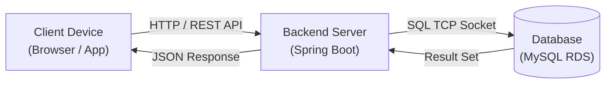
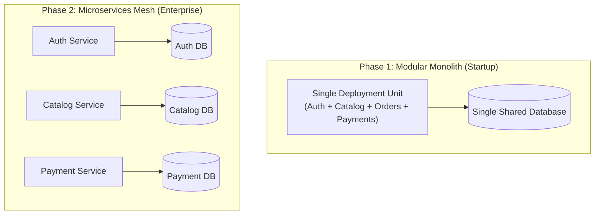
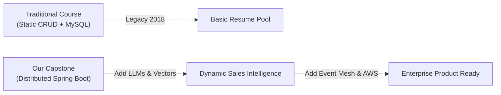
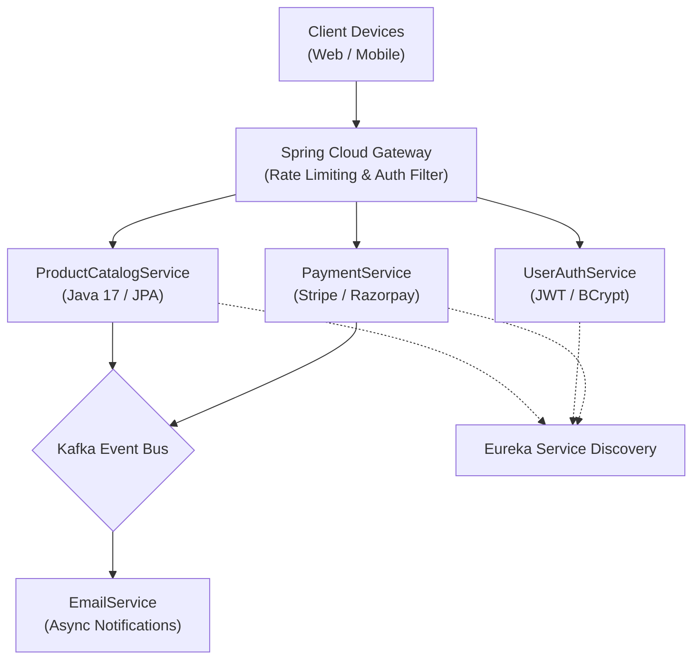

# Golden Reference Lecture Script: Intro to Backend Systems & AI-Augmented Development
## Program: Scaler Academy | Track: Backend Engineering Projects | Class 1 of 25 (Primer Day 1)
**Total Target Duration:** Exactly 105 Minutes Active Instruction (16 Modular Cards)  
**Audience:** Incoming Backend Engineering Students (Day 1 of Module, First Exposure)  
**Pedagogical Blueprint:** Socratic Intuition $\to$ Quantified Failure $\to$ Architecture Mental Models $\to$ 25-Class Roadmap $\to$ Visual Recap  
**Compliance Standard:** 100% Compliant with Scaler Good Script Rules (Zero em-dashes, 14–18 card deck, 4–10 min per card, exact sum = 105m, $\ge 4$ Mermaid diagrams, $\ge 2$ code traces, $\ge 3$ predict-before-reveals, $\ge 2$ quizzes with wrong options explained, 1 visual recap)

---

### CARD 1: Instructor Delivery Staging
- **Duration:** 2 Mins
- **Type:** Instructor Delivery Hint
- **Target Spoken Words:** ~65 words

Note for Instructor:
* **Delivery & Staging:** Treat today as a Socratic orientation with zero coding; keep energy high and pause 4–5 seconds after each question to acknowledge student names from the chat.
* **What Else You Can Teach:** If students ask about AI replacing backend engineers, explain that while AI automates repetitive boilerplate syntax, distributed system architecture, transactional isolation, and consistency invariants still demand human architectural judgment.
* **How To Do It:** Open a clean browser tab, navigate to a public REST endpoint (e.g., `https://api.github.com/users/octocat`), and show the raw JSON payload on screen to demonstrate that AI agents rely on structured backend endpoints to fetch ground-truth data.

---

### CARD 2: Nested Agenda & The Contents Page Hook
- **Duration:** 4 Mins
- **Type:** Nested Agenda & Socratic Framing
- **Target Spoken Words:** ~160 words

Important: You cannot build a complex distributed system until you understand the complete blueprint of what you are constructing.

Ask Learners: Whenever you are about to buy a technical book, what is the very first thing you look at?

*[Wait for answers: Pause 4 seconds for chat]*  
**Expected Answer:** The contents page: you skim what is inside before committing your time.

**Reveal Answer:**  
Exactly! Today is the contents page of our 2.5-month backend journey across 25 classes.

Here is our exact agenda for today's 105-minute masterclass:
1. **The Hidden Layer:** Client vs. Server vs. Database.
2. **Quantified Failures:** Why local storage and direct database access break security and consistency.
3. **Architectural Trade-offs:** Monoliths vs. Microservices.
4. **Engineering Standards:** The 5 Do's and 2 Don'ts of production software.
5. **The 25-Class Roadmap:** From Spring Boot basics to AI-augmented services on AWS.
6. **The ShopNest Capstone Ecosystem:** Walking through our enterprise project.

Drop a thumbs-up in chat if you are ready to explore the hidden layer of software!

---

### CARD 3: The Hidden Layer & Silicon Fabrication
- **Duration:** 6 Mins
- **Type:** Socratic Intuition & Daily-Life Analogy
- **Target Spoken Words:** ~280 words

`[Key] The backend is the invisible engine: if it operates flawlessly, users take it for granted; if it fails, the entire application collapses.`

**[ASK LEARNERS]**  
What is backend, really?

**[WAIT FOR ANSWERS]**  
**[EXPECTED ANSWER]** Something hidden from the user: a facade that the user never directly sees.

**[REVEAL ANSWER]**  
Right. Whenever you open any website, where is it actually pulling data from? A remote database? Another internal service?  
As end users, we do not know the internal intricacies, and that is the entire point.

**[ASK LEARNERS]**  
Take your smartphone. Have you ever worried about how the silicon chip inside was manufactured from raw sand and photolithography?

**[WAIT FOR ANSWERS]**  
**[EXPECTED ANSWER]** No, never.

**[REVEAL ANSWER]**  
We only evaluate specs: 256GB storage, 8GB RAM, camera resolution.  
The entire manufacturing and cleanroom fabrication process is, functionally, the "backend" of the phone. It is hidden, and it does not need to be visible for the consumer to experience the device.

`[Real-world] In production software, more than 85% of an engineering organization's compute and network bandwidth is spent inside backend infrastructure that users never directly see.`

---

### CARD 4: Walking Through a Live App (Client vs Server vs Database)
- **Duration:** 8 Mins
- **Type:** Socratic Architecture & Diagram
- **Target Spoken Words:** ~360 words

Important: The client and database must never communicate directly: the server/API layer acts as the mandatory gateway of trust and business computation.

Note for Instructor:
* **Delivery & Staging:** Spend 2 minutes sketching the three-tier flow live on your digital canvas before asking the incognito question.
* **What Else You Can Teach:** Introduce the concept of a Reverse Proxy (Nginx) and API Gateway as the security gatekeeper that shields the internal backend server cluster.
* **How To Do It:** Open Chrome DevTools on any live e-commerce website, click the Network tab, filter by 'Fetch/XHR', refresh, and show students the exact JSON response headers to make the client-server boundary visually concrete.

Ask Learners: When we open an application like Amazon or LinkedIn in an incognito window, which screen appears first?

**[WAIT FOR ANSWERS]**  
**[EXPECTED ANSWER]** The public landing page or login screen.

**[REVEAL ANSWER]**  
Right: that blank screen, sitting entirely on your local device without personal data, is the **Frontend** (the client side).

**[ASK LEARNERS]**  
Now, the instant we log in, what do we see? Does every student in this batch see the exact same feed?

**[WAIT FOR ANSWERS]**  
**[EXPECTED ANSWER]** No: everyone sees their own customized feed computed from their specific account.

**[REVEAL ANSWER]**  
So where does that data come from? Does the frontend talk directly to the database over the open internet?  
No: there is a secure server layer sitting in between.

#### Diagram 1: The Three-Tier Architecture


`[Remember] The frontend represents the presentation layer (HTML/CSS/React), while the backend handles computation and data authority (Java/Spring Boot).`

---

### CARD 5: Predict-Before-Reveal: Why Not Store Everything on the Device?
- **Duration:** 7 Mins
- **Type:** Predict-Before-Reveal & Quantified Failure
- **Target Spoken Words:** ~320 words

`[Key] Client-side storage fails both security and multi-device synchronization; mission-critical applications require an authoritative single source of truth.`

**[ASK LEARNERS]**  
Why can't we store all application data directly on the user's phone or laptop, and eliminate the remote database completely?

**[WAIT FOR ANSWERS]** *(Pause 5s for chat)*  
**[EXPECTED ANSWER]** Security risk if device is lost, and multiple devices cannot stay in sync.

**[PREDICT-BEFORE-REVEAL MOMENT 1]**  
**[ASK]** Predict what happens if you add an item to your cart on your phone, and then open the website on your laptop 10 seconds later, if data only lived locally on the phone.  
*[Pause for chat]*  
**[REVEAL]** Your laptop cart is completely empty! Because the laptop has no access to your phone's local storage.

#### Quantified Failure of Local Storage:
1. **Device Divergence:** A user with 3 devices (laptop, tablet, phone) maintains 3 conflicting cart states. In a food delivery app, this results in double-ordering or orphaned transactions.
2. **Data Wipeout:** If a phone drops in water or gets formatted, 100% of purchase history, wallet balances, and pending deliveries are permanently erased.

`[Mistake] Never assume client devices can coordinate distributed state without a central authoritative server.`

---

### CARD 6: Why We Need a Server Layer (Security & Credentials Gate)
- **Duration:** 8 Mins
- **Type:** Security Breach Trace & Quantified Failure
- **Target Spoken Words:** ~380 words

`[Key] Database credentials must never touch client code: the server layer encapsulates cryptographic validation, rate limiting, and business integrity.`

**[ASK LEARNERS]**  
Why can't the frontend just connect straight to the MySQL database over the network? Why pay for a server layer at all?

*[Wait for answers]*  
Look at what happens during a standard user login:

#### Code Trace 1: The Five Steps of Secure Server Authentication
```text
Step 1: Client sends raw payload: { "email": "rahul@scaler.com", "pass": "Secret@123" }
Step 2: Server queries database: SELECT id, password_hash FROM users WHERE email = ?;
Step 3: Server runs BCrypt verify: BCrypt.checkpw("Secret@123", db_hash) -> returns TRUE
Step 4: Server evaluates policy: Check rate limits (3 attempts left) and account status (ACTIVE)
Step 5: Server signs JWT: Generate cryptographic HMAC-SHA256 token and return to client
```

**[ASK LEARNERS]**  
If all of that verification happened directly inside JavaScript in the browser, what would an attacker do?

**[WAIT FOR ANSWERS]**  
**[EXPECTED ANSWER]** Open Developer Tools, inspect database credentials, and bypass the password check completely!

**[REVEAL ANSWER]**  
Exactly! If the frontend connects directly to your database, you must bundle database username and password inside the app. Anyone can decompile your code, read your master credentials in 10 seconds, and run `DROP DATABASE orders;`.

`[Real-world] At Uber, more than 4,000 backend microservices sit behind secure API gateways to ensure no raw database port is ever reachable from the public internet.`

---

### CARD 7: Interactive Quiz: Inventory Stock-Check
- **Duration:** 5 Mins
- **Type:** Socratic Check & Misconception Buster
- **Target Spoken Words:** ~210 words

`[Key] Real-time business validations must occur at the authoritative server layer, never on client caches.`

Question: A food-delivery app needs to check whether a restaurant still has an item in stock before letting a customer confirm their order. Where should that stock check happen?  
> A) On the frontend, because it already has the cart data loaded in memory  
> B) Nowhere: trust whatever inventory was last displayed on the screen  
> C) In the server/API layer, querying the authoritative database [CORRECT]  
> D) On the user's device, cached from when the app was launched  

**[EXPLANATION OF OPTIONS]**  
- **Why Option A & D are wrong:** Cached inventory on the client becomes stale within 200 milliseconds the moment another customer orders the final Biryani. Relying on local client memory leads to catastrophic overselling.
- **Why Option B is wrong:** Trusting visual screen state causes payment disputes and failed deliveries.
- **Why Option C is correct:** The server layer locks the inventory row or executes an atomic update (`UPDATE inventory SET stock = stock - 1 WHERE item_id = 101 AND stock > 0;`) against the single authoritative source of truth.

---

### CARD 8: Monolith vs. Microservices Architecture
- **Duration:** 8 Mins
- **Type:** Architectural Comparison & Diagram
- **Target Spoken Words:** ~370 words

`[Key] Startups build monoliths to maximize developer velocity; hyperscale platforms decompose into microservices to isolate fault domains and scale independently.`

**[ASK LEARNERS]**  
Is there always just one single backend codebase running behind every tech company?

**[WAIT FOR ANSWERS]**  
**[EXPECTED ANSWER]** It depends on company size and traffic scale.

**[REVEAL ANSWER]**  
Correct! Let us look at how systems evolve across two distinct stages of company growth.

#### Diagram 2: Monolith vs. Microservices Architecture (Branching Comparison)


#### The Trade-off Comparison:
1. **Modular Monolith:** One codebase, single deploy pipeline, zero network latency between modules. Perfect for teams under 20 engineers.
2. **Microservices Mesh:** Decoupled codebases, independent CI/CD pipelines, independent scaling. However, it introduces network latency, distributed transaction complexity, and multi-service debugging overhead.

`[Mistake] Decomposing into 15 microservices on Day 1 for a 50-user product slows down feature delivery by 400% without providing any operational benefits.`

---

### CARD 9: Predict-Before-Reveal: The 50-User Beta MVP Dilemma
- **Duration:** 5 Mins
- **Type:** Predict-Before-Reveal & Architectural Quiz
- **Target Spoken Words:** ~230 words

`[Key] Premature architectural distribution is the root cause of early-stage system failure.`

**[PREDICT-BEFORE-REVEAL MOMENT 2]**  
**[ASK LEARNERS]**  
A small team of 2 engineers is building an MVP product for 50 initial beta users. Predict which architectural choice allows them to ship fastest: 10 separate microservices with Docker and Kubernetes, or a single modular Spring Boot application?  
*[Pause for chat]*  
**[REVEAL]** The single modular application! Because 2 engineers spending time configuring Kubernetes ingress controllers and distributed tracing have zero bandwidth left to build actual product features.

Question: Which architecture makes engineering sense for this 50-user beta MVP?  
> A) 10 microservices deployed on Kubernetes, so it is ready for 5 million users  
> B) A clean modular monolith that is fast to build, with clean boundaries to split later [CORRECT]  
> C) Eliminate the backend server entirely and let the mobile app query MySQL directly  
> D) An event-driven Kafka stream with 8 separate consumer services  

**[EXPLANATION OF WRONG OPTIONS]**  
- **Options A & D:** Introduce distributed consensus, network serialization overhead, and deployment nightmares that bankrupt early projects.
- **Option C:** A critical security violation exposing database passwords to the world.
- **Option B:** The gold standard of software craftsmanship: build a clean modular monolith first, and carve out microservices only when traffic or organizational bottlenecks require it.

---

### CARD 10: Engineering Standards: The 5 Do's and 2 Don'ts
- **Duration:** 7 Mins
- **Type:** Professional Expectations & Production Mindset
- **Target Spoken Words:** ~320 words

`[Key] Senior engineers are distinguished by their debugging discipline, architectural curiosity, and automated testing rigor, not by syntax memorization.`
 
The tech industry has evolved. Memorizing syntax or leetcode tricks is no longer enough to succeed in senior backend roles.  
Hiring managers at top product companies evaluate your understanding of production engineering: dependency injection, database indexing, distributed tracing, and automated resilience.

#### The 5 Production Do's:
1. **Curiosity Over Memorization:** Read official framework documentation and inspect open-source GitHub implementations.
2. **Master Developer Tools:** Use Postman, Git CLI, Docker, and cloud consoles daily.
3. **Commit Clean Code Daily:** Write readable code with descriptive Git commits and clean branch hygiene.
4. **Learn by Hands-on Construction:** Build with Kafka, Redis, and Spring Security by wiring them into running services.
5. **Write Automated Unit Tests:** Follow the AAA (Arrange, Act, Assert) pattern and write Mockito slice tests.

#### The 2 Production Don'ts:
1. **No Spoonfeeding:** When you hit a bug, read the stack trace first, attempt a fix, and consult official docs before asking for help.
2. **No Rote Learning:** Understand the architectural "why" behind every annotation before typing it.

`[Remember] If you understand why Inversion of Control decouples classes, learning Spring Boot takes days instead of months.`

---

### CARD 11: The 25-Class Curriculum Roadmap: Stage 1 (Primer Classes 1 to 12)
- **Duration:** 9 Mins
- **Type:** Curriculum Blueprint Walkthrough
- **Target Spoken Words:** ~420 words

`[Key] Stage 1 takes you from fundamental version control to a live, secure, AI-augmented microservice deployed on AWS.`

**[SAY]**  
Our backend journey spans 25 intensive classes split into two coherent stages.  
Here is our exact progression across Stage 1 (The Primer Module):

#### Stage 1: Primer Module (Classes 1 to 12)
* **Chapter A: Foundations & Version Control (Classes 1 to 3)**
  - *Class 1:* Intro to Backend Systems & Architecture (Today)
  - *Class 2:* Git Internals, Object Trees, Commits & Branch Topology
  - *Class 3:* Git Commands, Merge Conflict Resolution & AI Developer Tooling
* **Chapter B: Spring Framework & First Microservice (Classes 4 to 5)**
  - *Class 4:* Inversion of Control (IoC), Dependency Injection & ApplicationContext
  - *Class 5:* Spring MVC, DTOs & Scaffolding ProductCatalogService
* **Chapter C: External Services & Relational Persistence (Classes 6 to 8)**
  - *Class 6:* Consuming 3rd-Party APIs & Live LLM Services (Groq / LLaMA 3.1)
  - *Class 7:* Spring Data JPA, Hibernate ORM & Entity Auditing
  - *Class 8:* JPQL Custom Queries, Relationships (@OneToMany) & Lazy vs. Eager Loading
* **Chapter D: Automated Testing (Class 9)**
  - *Class 9:* JUnit 5, AAA Pattern & AI-Assisted Boundary Testing
* **Chapter E: Security & Cloud Deployment (Classes 10 to 12)**
  - *Class 10:* AuthN vs. AuthZ, Password Hashing & Stateless JWT Anatomy
  - *Class 11:* Building UserAuthService & Stateless Token Verification
  - *Class 12:* Packaging Fat JARs & Deploying Live on AWS Elastic Beanstalk + RDS MySQL!

`[Real-world] By Class 12, your first two microservices will be live on public internet URLs with production database persistence.`

---

### CARD 12: Stage 2 (Advance Classes 13 to 25) & The AI Advantage
- **Duration:** 9 Mins
- **Type:** Advanced Distributed Systems & Diagram
- **Target Spoken Words:** ~440 words

`[Key] Stage 2 transforms your two core services into an enterprise-grade distributed mesh featuring resilience, caching, event streaming, and agentic workflows.`

#### Stage 2: Advance Module (Classes 13 to 25)
* **Chapter F: Resilience, Data Modeling & Mocking (Classes 13 to 15):** Resilience4j Circuit Breakers, Distributed UUIDs, and Mockito slice testing.
* **Chapter G: Enterprise Security & Cloud Networking (Classes 16 to 18):** OAuth 2.0 Google/GitHub Social Login, AWS VPC CIDR subnets, and RDS Multi-AZ.
* **Chapter H: Search & Payment Gateways (Classes 19 to 21):** SQL Pagination, Stripe & Razorpay SDKs, HMAC Webhook verification, and financial reconciliation.
* **Chapter I: Redis, Kafka & Microservices Mesh (Classes 22 to 24):** Cache-Aside patterns, Kafka event streams, Netflix Eureka dynamic service discovery, and Spring Cloud Gateway.
* **Chapter J: Production Multi-Container Orchestration (Class 25):** Multi-stage Dockerfiles and full Docker Compose mesh deployment!

#### Diagram 3: Flow from Standard CRUD to AI-Augmented Architecture


#### The AI Advantage:
1. **Live LLM Integration:** Your backend wires directly into Groq and LLaMA 3 to generate real-time product summaries.
2. **Semantic Search:** Moving beyond keyword matching by storing vector embeddings.
3. **Agentic Workflows:** Autonomous agents executing backend tool calls to manage orders.

---

### CARD 13: Capstone Ecosystem Walkthrough (The ShopNest PRD)
- **Duration:** 8 Mins
- **Type:** Concrete Project Architecture & Timed Reading Window
- **Target Spoken Words:** ~290 words

Important: Enterprise engineering requires reading technical specifications before writing code: the PRD defines the architectural boundaries of ShopNest.

Dataset link: https://github.com/scaleracademy/shopnest-backend-primer/tree/main/specs

Throughout both modules, we build one unified, enterprise-grade e-commerce ecosystem called **ShopNest**.  
Here is our system architecture across the two modules:

#### ShopNest Two-Module Architecture
1. **Module 1 (Primer):**
   - `ProductCatalogService`: Handles product inventory, supplier synchronization, and AI sales pitches.
   - `UserAuthenticationService`: Handles registration, BCrypt password hashing, and signed JWT issuance.
   - Automated testing suite and live AWS Elastic Beanstalk deployment.
2. **Module 2 (Advance):**
   - `PaymentService`: Strategy pattern routing across Stripe and Razorpay with webhook reconciliation.
   - `EmailService`: Event-driven consumer listening to Apache Kafka topics.
   - `Eureka Service Registry` & `Spring Cloud Gateway` routing.

Note for Instructor:
* **Delivery & Staging:** Strictly enforce the 3-minute silent reading window. Mute your microphone and share a countdown timer on screen so students genuinely skim the PRD specification without distractions.
* **What Else You Can Teach:** Explain how tech giants like Amazon, Stripe, and Google use PRDs and RFC (Request for Comments) documents to resolve architecture and database schema debates *before* writing a single line of code.
* **How To Do It:** Share your screen on Section 3 of the ShopNest PRD, highlight the `POST /api/v1/products` request body, and explain that in production, frontend and backend engineering teams freeze this exact JSON schema contract weeks before deployment.

*[Pause 3 minutes for student reading window]*

---

### CARD 14: Step-by-Step Code Trace: Health Check Endpoint Scaffold
- **Duration:** 7 Mins
- **Type:** Step-by-Step Code Trace & Failure Mode
- **Target Spoken Words:** ~310 words

Note: Every microservice begins with a deterministic health probe that verifies server availability and database connectivity.

Even though today is orientation with zero live coding, let us look at the anatomy of the very first endpoint we will build together in Spring Boot.

#### Code Trace 2: Spring Boot Health Controller
```java
// Target Platform: Java 17 | Spring Boot 3.2.0
@RestController
@RequestMapping("/api/v1/health")
public class SystemHealthController {

    @GetMapping
    public ResponseEntity<Map<String, Object>> checkHealth() {
        // Step 1: Prepare metadata payload
        Map<String, Object> status = new HashMap<>();
        status.put("service", "ShopNest-Catalog");
        status.put("status", "UP");
        status.put("timestamp", Instant.now().toString());
        
        // Step 2: Return HTTP 200 OK with JSON body
        return ResponseEntity.ok(status);
    }
}
```

#### Step-by-Step Walkthrough:
* **Step 1:** Annotate class with `@RestController` and map path `/api/v1/health`.
* **Step 2:** Construct payload map with service name, status `UP`, and ISO-8601 timestamp.
* **Step 3:** Return `ResponseEntity.ok(status)` producing an HTTP 200 JSON response.
* **Walkthrough Contract:**
  - What to Run: Issue `curl -X GET http://localhost:8080/api/v1/health` in your terminal.
  - What Success Looks Like: HTTP 200 response with `{"service":"ShopNest-Catalog","status":"UP"}` in under 15 milliseconds.
  - Likely Failure Mode: If port 8080 is already bound by another background process, Spring Boot fails on startup with `PortAlreadyInUseException`. The fix is overriding `server.port=8081` in `application.properties`.

---

### CARD 15: Curated Student FAQs (Anticipated Doubts)
- **Duration:** 6 Mins
- **Type:** Preemptive FAQ & Misconception Buster
- **Target Spoken Words:** ~280 words

Important: Clarifying foundational expectations early eliminates cognitive friction during hands-on coding classes.

Doubt by Learner: Why Java and Spring Boot instead of Python or Node.js?
- **Answer:** While Python excels in data science and Node.js in rapid prototyping, Java powers over 75% of global enterprise backend systems due to type safety, predictable multi-threading, and enterprise framework longevity. Mastering Spring Boot makes transitioning to any other language trivial.

Doubt by Learner: What if I have never written a line of Java before?
- **Answer:** We scaffold Java concepts from the ground up starting next week. The core principles of backend engineering (data flow, client/server boundaries, database queries) are language-agnostic.

Doubt by Learner (Optional): Are class recordings sufficient if I cannot attend live?
- **Answer:** Recordings are a revision backup. Attending live allows you to participate in Socratic dialogues, code along during live edge-case debugging, and get doubts resolved immediately.

---

### CARD 16: Final Visual Mental Model Recap & Homework Bridge
- **Duration:** 6 Mins
- **Type:** Visual Mental Model Recap & Homework
- **Target Spoken Words:** ~270 words

`[Key] The entire 25-class backend journey converges into one coherent distributed ecosystem.`

#### Diagram 4: Master Visual Mental Model Recap (ShopNest Complete Ecosystem)


#### Homework & Action Items:
1. **Developer Pack:** Fill out the Student Developer Pack form using your Scaler email to receive free IntelliJ Ultimate and GitHub Copilot licenses.
2. **Tooling Setup:** Install Postman or Insomnia on your laptop ahead of next week.
3. **PRD Review:** Read the ShopNest Phase 1 specification fully at home.
4. **Bridge to Class 2:** In our next class, we dive into **Git Internals & Object Trees**: the fundamental version control bedrock every professional engineer masters before writing application code.

`[INSTRUCTOR NOTE: Start the unbounded live doubt session here. Answer individual student questions in chat one by one.]`  
*Class dismissed!*
