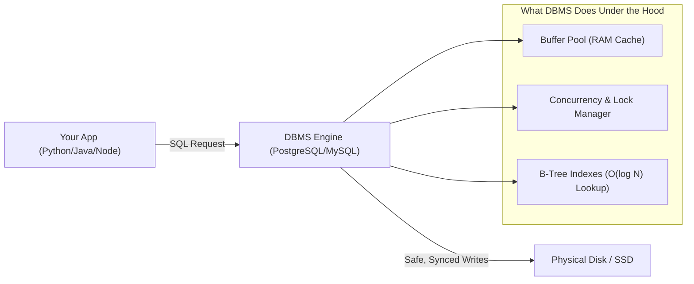
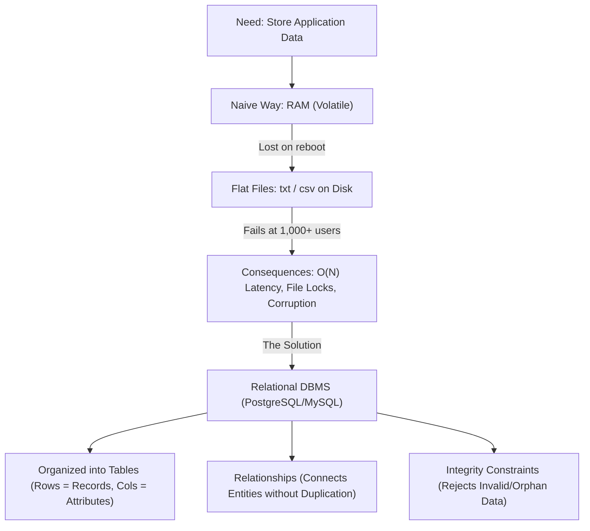

# Golden Reference Lecture Script: Introduction to DBMS & Relational Modeling
## Program: Academy | Track: Backend & Databases | Class 1 of 12
**Target Duration:** Configurable (90 Minutes Selected | Scales to 45, 60, 90, 120 Mins)  
**Audience:** Intermediate Learners (Working Devs & CS Grads; Know Basic DSA & Programming)  
**Pedagogical Model:** Socratic Intuition $\to$ Naive File Failure $\to$ Relational Need $\to$ Hands-on Modeling  

---

### DYNAMIC TWO-WAY OPENING HOOK ADAPTERS (By Program, Track & Audience Level)
The engine automatically crafts the opening sequence with:
1. **Warm Welcome & Room Ping** (audio/video check, chat warmup).
2. **Prerequisite & Level Acknowledgement** (acknowledging what they already know based on their chosen track/level).
3. **Two-Way Socratic Hook** (interactive question, waiting for chat responses, reacting to student names).

#### 1. Academy: Backend Engineering — Intermediate Track
*(Configured by SME: Audience = Intermediate | Ratio = 70% Theory : 30% Code Demo)*

> **Instructor (Spoken in simple, natural English):**  
> *"Good evening, everyone! Welcome to Class 1 of our Database & SQL module. Before we start, let's do a quick mic and video check: if you can hear me and see my screen clearly, type '1' or 'Yes' in the chat!*  
> *[Pause 3 seconds — Read chat: 'Awesome, thanks Ankit, Sneha, Rohan!']*  
>  
> *Since you are in our **Intermediate Backend Track**, I know you already know basic programming in Python, Java, or C++. You already know how to write functions, use arrays, and create basic web apps. So you have the basics ready.*  
>  
> *Now, let me ask you a real-world question. Imagine you and your friends build a campus food ordering app called **CampusBites**. You don't have a database yet, so when students order lunch, your code just saves their orders into a normal text file called `orders.txt` on your server.*  
>  
> *Tell me in the chat: what will happen to your server the moment 50 students click 'Order Now' at the exact same second during lunchtime?*  
> *[Pause 5 seconds for chat — Read responses: 'File gets locked!', 'Server hangs', 'Error!']*  
>  
> *Spot on, Vikram and Pooja! The file gets locked!*  
>  
> *To visualize this, think of the **canteen order counter**:*  
> *Imagine the college canteen has **only ONE paper notebook and ONE pen** on the desk for all student orders. If one student comes every 10 minutes, writing in that notebook is smooth. But at 1:00 PM, when 50 hungry students rush to the counter at the exact same second, all trying to grab that **ONE single pen** and write on the **SAME line** at the same time... what happens?*  
>  
> *They fight for the pen, a huge crowd gets stuck waiting, and names get scribbled over each other! That is exactly what happens with a normal text file on a computer: only ONE program can hold the pen at a time.*  
>  
> *A Database, on the other hand, is like giving every student their own digital scanner so all 50 orders are accepted together instantly without anyone waiting. Today, we're going to build CampusBites step-by-step and see how a database powers it under the hood."*

---

### CARD 1: Instructor Warm-up & Delivery Staging
- **Duration:** 2 Mins
- **Type:** Instructor Delivery Hint
- **Spoken Words:** ~60 words

> **Instructor Delivery Hint:**  
> Stick strictly to our single running example: **CampusBites**. Do not switch to bank transfers, libraries, or other apps halfway through. Keeping one running story keeps students fully immersed and focused on the database mechanics.

---

### CARD 2: The Roadmap & Two-Way Hook (Spoken Agenda)
- **Duration:** 3 Mins *(Scales dynamically to custom class duration)*
- **Type:** Two-Way Spoken Agenda & Hook
- **Spoken Words:** ~150 words

"Over the next 90 minutes, we are going to crack three exact questions using our CampusBites app:

1. **The In-Memory Trap:** Why saving orders in RAM or Python arrays wipes out student orders the moment your server restarts.
2. **The Breaking Point of Files:** Why our `orders.csv` file completely breaks once CampusBites grows to 5,000 orders (with exact numbers on latency and file corruption).
3. **The Relational Blueprint:** How we organize CampusBites into clean Tables (Students and Orders) so data never duplicates and queries run in 2 milliseconds.

Drop a thumbs-up in the chat if you're ready to build CampusBites with me!"

---

### CARD 3: How Would YOU Store Data? (The In-Memory Trap)
- **Duration:** 7 Mins
- **Type:** Learner Intuition & Naive Attempt
- **Spoken Words:** ~320 words

"Let’s start with our CampusBites app. 

You know Python, Java, or C++. You know Arrays and HashMaps. 

A student named Rahul places an order for a Roll. You take his name, room number, and order item. You store it in memory: `orders[101] = { name: 'Rahul', room: 'B-204', item: 'Paneer Roll' }`. 

Everything works great while your server is running. But what happens at 2:00 AM when your laptop battery drains or you restart your server?

**Drop your answer in the chat:** Where did Rahul’s order go?

*[Pause 5 seconds for chat: 'RAM cleared', 'Data lost', 'Gone!']*

Exactly, Priya and Rohan! RAM is temporary memory. The moment the power cuts, your data is erased. 

So what is the most natural next step every developer takes? We save it to a physical file on our disk: `orders.csv`."

---

### CARD 4: Storing Data in Flat Files (The Naive Working Model)
- **Duration:** 6 Mins
- **Type:** Small-Scale Walkthrough
- **Spoken Words:** ~280 words

"Let’s look at our `orders.csv` file when CampusBites has just 10 customers and 50 orders:

```text
order_id, student_name, room_no, phone, item_name, price, timestamp
101, Rahul Sharma, B-204, 9876543210, Paneer Roll, 120, 2026-10-06 12:30
102, Priya Singh, A-102, 9123456780, Veg Biryani, 180, 2026-10-06 12:32
103, Rahul Sharma, B-204, 9876543210, Cold Coffee, 60, 2026-10-06 12:45
```

At small scale, this works fine:
- Want to add an order? Append a line at the bottom.
- Want to check Priya's order? Loop through the lines and check `if row[1] == 'Priya Singh'`.

If you only have 10 orders, this script takes less than 1 millisecond. You might think: *'Why do companies pay money for databases if a simple CSV file works?'*

Now, let’s watch CampusBites grow and see where this file crashes."

---

### CARD 5: The Quantified Breakdown (Why Files Fail at 5,000 Orders)
- **Duration:** 8 Mins
- **Type:** Quantified Failure & Conflict
- **Spoken Words:** ~360 words

"Fast forward 6 months. CampusBites is now used by 5,000 students across the entire campus, with 100,000 order records. Our `orders.csv` file is now 250 Megabytes.

Here is what happens under the hood:

**1. Slow Linear Searches ($O(N)$):**  
To check if Rahul has an active order, your Python code has to read 100,000 lines from disk into memory. On a server, reading a 250MB file line-by-line takes **1.2 to 2.8 seconds**! For just one simple lookup!

**2. File Lock Collisions:**  
At 1:00 PM, 50 students order at the exact same millisecond. Remember the single pen at the canteen desk? In the operating system, only one process can write to `orders.csv` at a time. The file gets locked, other student orders time out, or worse: orders overwrite each other and lines get corrupted.

**3. Repeated Data & Update Headaches:**  
Notice lines 101 and 103: Rahul’s phone number and room number are repeated on every single food item he orders. If Rahul shifts to room `C-301`, you have to find and update every past order line. If the server shuts down halfway through, Rahul has two different rooms in your file!

> **[Key Takeaway]**  
> Normal files give you **storage**, but they give you zero **speed**, zero **concurrency safety**, and zero **consistency**."

---

### CARD 6: Predict-Before-Reveal: The CampusBites Wallet Dilemma
- **Duration:** 5 Mins
- **Type:** Predict-Before-Reveal Interactive Moment
- **Spoken Words:** ~210 words

"Let’s see what happens if we add a **CampusBites Wallet** balance feature.

Suppose Rahul has ₹200 stored in his CampusBites wallet in a text file: `balance = 200`.

At the exact same second:
1. Rahul orders a Burger for ₹150 on his phone.
2. A scheduled tea delivery for ₹100 auto-debits on his laptop.

**Type in chat:** What will happen if our code does a simple `read balance -> check if balance >= amount -> write new balance` without database transaction locks?

*[Pause 5 seconds — Read chat: 'Both orders go through!', 'Negative balance!', 'Double spend!']*

Exactly! Both processes read `balance = 200` at the exact same millisecond!  
Burger process checks: *200 >= 150? Yes!* Writes new balance = 50.  
Tea process checks: *200 >= 100? Yes!* Writes new balance = 100.  
Both orders are confirmed! Rahul just spent ₹250 using a ₹200 wallet! 

This is why apps cannot use plain text files for money or critical data."

---

### CARD 7: Enter DBMS: The Engine Between You and Your Disk
- **Duration:** 6 Mins
- **Type:** The Solution Reveal & Core Mental Model
- **Spoken Words:** ~290 words

"This brings us to the **AHA! Moment**. 

A **Database Management System (DBMS)** is not just a place where data sits. 
A DBMS is a **high-performance software engine** that sits between your application code and the physical storage disk.



When you ask a DBMS for data:
1. It does not scan lines from top to bottom; it uses **Indexes** to jump to the exact byte in 2 milliseconds.
2. When 100 users write simultaneously, its **Transaction Manager** isolates them so balances never corrupt.
3. It guarantees that a system crash mid-write leaves your data in a clean, recoverable state."

---

### CARD 8: What is "Relational Data"? (The Two-Table Revelation)
- **Duration:** 8 Mins
- **Type:** Concept Breakdown with Concrete Example
- **Spoken Words:** ~340 words

"Now let’s look at the word **'Relational'**. What does that actually mean?

Earlier, in our single CSV file, we jammed the student's personal details and the food item details into the same row:
`[order_id, student_name, student_phone, student_room, item_name, price]`

This is called **Unstructured / Denormalized Data**. It forces you to repeat Rahul's phone number on every single pizza he buys.

How does a **Relational Model** solve this? 
It splits real-world things into dedicated **Tables**:

1. **Table 1: Students (The Entity)**
| student_id | student_name | phone | room_no |
| :---: | :--- | :--- | :--- |
| **1** | Rahul Sharma | 9876543210 | B-204 |
| **2** | Priya Singh | 9123456780 | A-102 |

2. **Table 2: Orders (The Transaction)**
| order_id | student_id | item_name | price | timestamp |
| :---: | :---: | :--- | :---: | :--- |
| **101** | **1** | Paneer Roll | 120 | 12:30 PM |
| **102** | **2** | Veg Biryani | 180 | 12:32 PM |
| **103** | **1** | Cold Coffee | 60 | 12:45 PM |

Look at Table 2. Notice how we didn't repeat Rahul’s phone number or room? We only stored `student_id = 1`. 

**This is a Relationship.** Table 2 connects to Table 1 through a shared identifier (`student_id`). 
If Rahul changes his phone number tomorrow, how many rows do you update? **Exactly one.**"

---

### CARD 9: Anatomy of a Table: Rows vs. Columns
- **Duration:** 6 Mins
- **Type:** Mental Model Framing
- **Spoken Words:** ~260 words

"Let's formalize this into clean mental models:

A **Table** is simply a grid of rows and columns designed with mathematical rules:
1. **Each Row represents an Entity Instance (A Record):**
   - Row 1 is *one specific person*: Rahul Sharma.
   - Row 2 is *another specific person*: Priya Singh.
   - In a database, each row MUST be uniquely identifiable—which is why we give it an ID (Primary Key).
2. **Each Column represents an Attribute (A Property):**
   - `student_name`, `phone`, `room_no` are properties that describe every student.
   - Every column enforces a strict **Data Type**: you cannot accidentally store `'abc'` inside a `price` column.

> **[Remember]**  
> Rows represent *Who* or *What* (records). Columns represent *Characteristics* (attributes)."

---

### CARD 9B: The Beginner Micro-Syntax Bridge (Translating SQL to English)
- **Duration:** 4 Mins
- **Type:** Beginner Micro-Code Demo (Zero-Boilerplate Rule)
- **Spoken Words:** ~190 words

"Now, how do we actually talk to this table? 

We don't need 50 lines of complex connection code today. Look at how friendly and human SQL is:

```sql
SELECT student_name, room_no
FROM students
WHERE room_no = 'B-204';
```

Notice how this reads almost like a normal English sentence:
- **`SELECT student_name, room_no`**: You are telling the computer: *'Pick out just these two columns for me.'*
- **`FROM students`**: You are telling the computer: *'Look inside the students table.'*
- **`WHERE room_no = 'B-204'`**: You are saying: *'Only show me students who live in room B-204.'*

*[Pause 3 seconds]*  
**Drop a thumbs-up in the chat:** Isn't that so much cleaner than writing a 15-line `for` loop in Python to open a file and check `if row[3] == 'B-204'`? That is the power of a database query!"

---

### CARD 10: Interactive Chat Quiz: Spot the Anomaly
- **Duration:** 5 Mins
- **Type:** Live Engagement Quiz
- **Spoken Words:** ~190 words

"Let's test our understanding with a quick challenge.

Suppose an intern creates an `Orders` table with these columns:  
`order_id, student_name, student_address, restaurant_name, restaurant_address, item_name, price`.

If a restaurant changes its address from *Indiranagar* to *Koramangala*, what problem does this design create?

**Options:**
- **A)** The queries will run slower because the text is longer.
- **B)** Update Anomaly: You must update thousands of historical order rows, risking partial updates if a crash happens.
- **C)** SQL syntax error because tables cannot have two address columns.
- **D)** Nothing; this is the recommended design for databases.

**Drop your answer in the chat: A, B, C, or D!**

*[Pause 5 seconds]*  
The answer is **B**! If you store restaurant address inside every order, updating one restaurant requires modifying 10,000 rows. In a Relational Database, restaurant addresses live in a separate `Restaurants` table!"

---

### CARD 11: What is "Integrity" and Why Does It Save Your App?
- **Duration:** 6 Mins
- **Type:** Concept Deep-Dive
- **Spoken Words:** ~280 words

"Earlier, the old textbook notes gave you a bullet point saying: *'Integrity: Rules ensure data remains accurate.'* That sounds abstract. Let’s make it concrete.

What is **Data Integrity** in real life?
Imagine someone tries to place an order where `student_id = 9999`, but student 9999 doesn't exist in your college! 
In a flat text file, your Python script writes it without flinching. Now you have an **orphan order** that belongs to nobody!

Or imagine someone inputs `price = -500`. The file saves it, and your company loses money.

In a Relational Database, we set **Integrity Constraints**:
- **Entity Integrity:** Every row must have a unique Primary Key (no duplicate student IDs).
- **Referential Integrity:** An order CANNOT point to a `student_id` that doesn't exist in the `Students` table. The database will literally reject the query and throw an error: *'Foreign Key Constraint Violated'*.
- **Domain Integrity:** Price must be a positive integer; date must be a valid timestamp.

The database acts as your **24/7 security guard** that protects your data from buggy application code."

---

### CARD 12: Recap & The Visual Mental Model
- **Duration:** 5 Mins
- **Type:** Visual Synthesis & Class Wrap-up
- **Spoken Words:** ~220 words

"Let’s tie everything we learned today into one complete mental model:



**Next Session Cliffhanger:**  
In our next class, we are going to write our very first SQL queries to talk to this DBMS engine. We will write `SELECT`, `WHERE`, and `JOIN` commands to pull real data from our CampusBites tables in under 3 milliseconds!

Thank you, everyone! See you in Class 2!"
