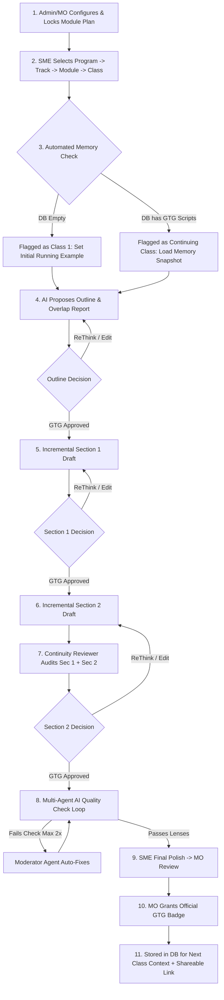

# Product Requirements Document (PRD) Analysis
## Script Creation & Content Authoring Tool (Scaler)
**Author of PRD:** Ankit Mishra (`ankit.mishra@scaler.com`)  
**Refined Engineering Architecture:** Cumulative Curriculum Memory & Incremental Gated Authoring  

---

## 1. Executive Summary: What is This Tool?

The **Script Creation & Content Authoring Tool** is an AI-powered, multi-agent editorial platform tailored for Scaler's technical education curriculum. 

Rather than treating a lecture as an isolated text document, this platform operates on a **curriculum-aware hierarchical graph** (`Program -> Track -> Module -> Class`). It automates the generation of 90-minute lecture scripts (structured as interactive teaching cards) while guaranteeing:
1. **Automated Cross-Class Context Awareness:** Seamless cumulative memory across a module without manual file uploads. The system queries approved (GTG) scripts from its database to determine if a class is the inaugural session (Class 1) or a continuing session (Classes 2..N), automatically preserving running examples and terminology.
2. **Technical Freshness:** Real-time retrieval and grounding in current official documentation rather than scraped, hallucinated, or obsolete code patterns.
3. **Incremental Section-by-Section Authoring:** Replaces monolithic 8,000-word hallucinations with controlled section-by-section drafting, evaluated at every milestone with a 3-way decision gate (`[GTG]`, `[Edit]`, `[ReThink]`).
4. **Multi-Agent Quality & Continuity Assurance:** Automated continuity review between sections + independent reviewer personas (Beginner, Advanced, SOP) with self-healing moderator loops.
5. **Governance & Role-Based Control:** Strict workflow gates leading to an official "Good To Go" (GTG) certification signed off by a Module Owner (MO), with live visibility for Program Managers.

---

## 2. Problem Statement & Value Proposition

| Current Pain Point | Root Cause | Solution Delivered by Tool |
| :--- | :--- | :--- |
| **High Turnaround Time (TAT)** | Subject Matter Experts (SMEs) and instructors spend hours manually drafting scripts from scratch. | AI drafts structured outline and card-by-card scripts in minutes, shifting SME role from *author* to *editor/reviewer*. |
| **Bloated, Unteachable Scripts** | LLMs generate dense narrative essays that cannot be delivered line-by-line in live classes. | Strict **Card Token & Brevity Engine** (14–18 cards per 90-min class, max 250–400 words/card, max 2–4 sentences/paragraph). |
| **Cross-Class Amnesia & Topic Bleed** | Classes generated in silos; instructors re-explain prerequisites or overstep into future lectures. | **Automated Database Memory Engine** retrieves prior GTG concepts and strictly locks upcoming class boundaries. |
| **Outdated Technical Material** | Rapidly shifting SDKs and APIs lead to obsolete syntax in lecture demos. | Grounding in verified, official documentation sources + live web-search with manual validation flags. |

---

## 3. Scope & Structural Hierarchy

### 3.1 Taxonomy
- **Program:** High-level educational domain (e.g., Academy, DSML, AIML, DevOps, and FDE).
- **Track:** Specialized career/tech path within a program (e.g., Academy's DSA, SQL, Backend, Full Stack, Data Engineering).
- **Module:** Curricular unit grouping cohesive classes, tagged as `Core`, `Elective`, or `Specialisation` (e.g., MERN, System Design).
- **Class:** Individual instructional session (Live, Inverted, or Lab) with a target duration (typically 90 minutes / 14–18 concept cards).
- **Learner Levels:** Configurable learner segments (`Beginner`, `Intermediate`, `Advanced`).

---

## 4. Role-Based Access Control (RBAC) Matrix

| Role | Core Responsibilities | Access Scope | Write / Edit Permissions | Approval Rights |
| :--- | :--- | :--- | :--- | :--- |
| **Admin** | Configures programs, tracks, learner levels, user roles, module tags | System-wide | Full system settings and structural schemas | System overrides |
| **Module Owner (MO)** | Curates/parses syllabus, locks module plans, binds doc links, reviews continuity | Programs they belong to | Syllabus/modules, class lists, script reviews | **Sole authority to grant GTG mark** |
| **SME / Author** | Generates outlines, drafts sections via 3-way gates, edits scripts with inline AI assist | Programs they have joined | Class scripts, outlines, section edits | SME Review pass |
| **Program Manager (LO Team)** | Monitors velocity, module health, syllabus coverage, and TAT | All programs | View-only access across all programs | None (Live tracker) |

---

## 5. End-to-End Workflow Breakdown



1. **Module Setup & Plan Lock:** MO/Admin uploads syllabus (parsed by AI) or enters classes manually. Plan is locked.
2. **Cascading Dropdowns (SME):** SME selects Program $\to$ Track $\to$ Module $\to$ Class.
3. **Automated Curriculum Memory Lookup:**
   - If DB has 0 approved scripts $\to$ Inaugural Class 1 mode (establishes domain example).
   - If DB has prior approved scripts $\to$ Continuing Class mode (loads terms mastered, running example state, and code signatures). Zero manual uploads!
4. **Outline Generation & Overlap Audit:** AI checks past and future classes and generates an outline.
5. **Interactive 3-Way Decisions:** Every milestone offers: `[GTG]`, `[Edit]`, or `[ReThink]`.
6. **Section-by-Section Drafting & Continuity:**
   - Section 1 created $\to$ Reviewed $\to$ GTG.
   - Section 2 created $\to$ Continuity Reviewer inspects Section 1 + Section 2 together $\to$ Reviewed $\to$ GTG.
7. **Multi-Agent Quality Check Loop:** Reviewer personas (Beginner, Advanced, SOP) audit full script; Moderator auto-fixes (up to 2 iterations).
8. **MO Sign-off & Automated Memory Archival:** Module Owner gives the official **GTG** stamp. The approved script is saved to the database, automatically updating the curriculum memory for the next class.

---

## 6. Functional Requirements Breakdown (FR-1 to FR-23)

### Onboarding & Permissions
- **FR-1:** *Every SME/Author and Program manager is asked to join a program, and a track where the program has tracks, when onboarded.*
- **FR-2:** *People see and work on content only in programs they have joined. Program Managers retain global read-only visibility.*

### Curriculum Structure & Gating
- **FR-3:** *A module and its class list can be entered manually, uploaded as a syllabus that the AI parses, or both.*
- **FR-4:** *Entered or parsed module plans go through a review step before they are locked.*
- **FR-5:** *MOs and Admins can edit modules and class lists from the Admin end, including after locking.*
- **FR-6 (Critical Gate):** *Script creation for a program stays disabled until at least one complete module exists (Title, Agendas, Learning Outcomes, and Assigned SME).*

### Curriculum Context & Automated Memory
- **FR-7:** *The system stores the class sequence of each module and program, with each class marked taught or upcoming.*
- **FR-8 (Automated Memory Engine):** *Every draft automatically queries the database of approved GTG scripts for prior classes. Zero manual uploads required. Auto-detects Class 1 vs Continuing Classes.*

### Authoring & Section Gating
- **FR-9:** *SME/Authors start from cascading dropdowns; the AI proposes a class outline first.*
- **FR-10:** *The outline flags overlap with past and upcoming classes. Interactive 3-way gate: GTG, Edit, ReThink.*
- **FR-11:** *Inline AI assist is available while SME/Authors edit a script.*
- **FR-11b (Incremental Authoring):** *Scripts are drafted and approved section-by-section with live cross-section continuity auditing.*

### Grounding & References
- **FR-12:** *Each module has a pre-approved list of official documentation sources bound by the MO; the AI may also search the web to fill gaps.*
- **FR-13:** *Each script lists the documentation it relied on, with links and the date they were retrieved.*
- **FR-14:** *References found by search outside the approved list are labelled so the SME can validate them before use.*

### Release & Review Lifecycle
- **FR-15:** *Every script has a shareable link from creation; it carries an official GTG (good to go) mark only after the MO approves it.*
- **FR-16:** *Scripts follow one status flow: Not Started $\to$ Script WIP $\to$ SME Review $\to$ MO Approval $\to$ GTG.*
- **FR-17:** *When a script fails an AI quality check, the AI fixes issues and re-checks in a loop, at most 2 times.*

- **FR-18:** *Each class records its class type (Live, Inverted, Lab), module tag (Core, Elective, Specialisation), and content change %.*
- **FR-19 (Context — Refined Architecture):**
  - *Original PRD Text:* MOs and SME/Authors can attach previous scripts of the same classes as reference for the AI draft.
  - *Refined System Requirement:* **Zero-Upload Automated Database Memory.** Approved (GTG) class scripts are automatically stored and indexed in the module database. When an SME initiates script generation for any class, the system auto-queries the database:
    1. **Empty DB (Class 1):** Automatically identifies this as the inaugural session of the module. Sets up foundational mental models and introduces the primary running example.
    2. **Existing DB (Classes $\ge$ 2):** Automatically extracts and passes the previous script context (terms mastered, active code state, and prior cliffhanger) directly to the prompt.
    - *Benefit:* Eliminates manual file hunting and uploading, prevents version mismatch, and guarantees unbroken cross-class continuity.
- **FR-20:** *Scripts can include animations, images and flow diagrams, made with Mermaid or other free resources.*

### Evaluation & Outputs
- **FR-21:** *The SME or MO can evaluate a created script through human evaluation in a chat-based environment.*
- **FR-22:** *Golden datasets measure the quality and delivery parameters of created scripts.*
- **FR-23 (v2 Scope):** *Tool can create assignments documentation and mock interview questions based on current industry asks.*

---

## 7. Multi-Agent Architecture & Review Lenses

| Agent Name | Function | Detailed Responsibility |
| :--- | :--- | :--- |
| **Writer Agent** | Content Generator | Drafts outline and incremental section cards based on module context and docs. |
| **Continuity Reviewer Agent** | Flow & Cohesion Auditor | Evaluates Section $N$ in context of Sections $1..N-1$ to ensure identical variable names, running example integrity, and smooth transitions. |
| **Reviewer Agent (Beginner Lens)** | Persona Auditor | Flags cognitive overload, missing foundational concepts, unexplained jargon. |
| **Reviewer Agent (Advanced Lens)** | Persona Auditor | Checks technical accuracy, depth, edge cases, and oversimplification. |
| **Reviewer Agent (SOP & Brevity)** | Anti-Bloat & Rule Compliance | Checks strict word limits (250–400 w/card), max 2–4 sentences/paragraph, zero em-dashes, exact time budgeting. |
| **Moderator Agent** | Conflict Resolver & Fixer | Reconciles conflicting feedback between lenses, applies fixes, re-runs audit (up to 2x). |
| **Attributes Generator Agent** | Visual Asset Creator | Generates Mermaid diagrams ($\le 7$ nodes), step-by-step code traces, and CSS animations. |

---

## 8. Pedagogical Analysis: The "Good Script Rules"

```
[Teaching Shape of Every Concept]
Why (Everyday Analogy & Real Problem) 
  └─► What (Naive approach breaking at scale)
        └─► How (Quantified Failure -> Correct Architecture)
              └─► Where (Production Context: Netflix, Uber, Swiggy)
                    └─► What Breaks (Edge cases, Memory, Concurrency)
```

### Essential Constraints Checklist:
- **Card-Based Deck:** 4–10 minutes per card; 14–18 cards per 90-minute class (~3,800–4,200 total spoken words).
- **Never start with a definition:** Always begin with a relatable problem or small-scale attempt that fails.
- **Quantified Failure:** Show the naive approach breaking at scale (e.g., *"At 10,000 req/sec, connection pool exhausts in 42ms"*).
- **Single Running Example:** One scenario grown visually throughout the class and module.
- **Online Interaction Rules:** Only chat-typed answers or binary thumbs-up/down.
- **Formatting Constraints:** No raw HTML/tables inside teaching cards; zero em-dashes (`—`); address learner directly as "you".
