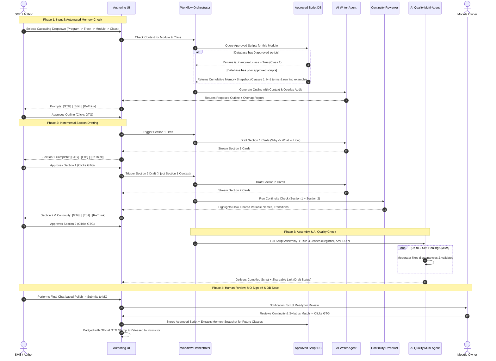
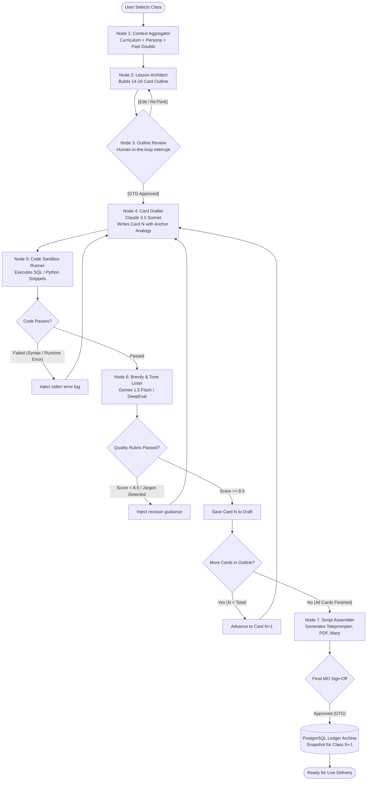

# System Architecture & Detailed Workflow Blueprint
## AI-Powered Script Creation & Content Authoring Platform

---

## 1. Executive Vision & Problem Alignment

### The Reality of Technical Lecture Delivery
Technical instructors cannot present effectively from disjointed bullet points, generic slide summaries, or raw LLM drafts. They need **turn-by-turn, line-by-line verified instructional scripts** that:
- Speak directly to the student ("you").
- Follow strict time budgeting (e.g., 90 minutes partitioned into 4–10 minute concept cards).
- Never hallucinate deprecated API syntax.
- Maintain seamless pedagogical continuity from minute 0 to minute 90.

### Verbatim PRD Specification: Goals and Non-Goals
v1 succeeds if script creation takes less instructor and SME time and finishes faster with better quality of scripts created by humans, while every script stays curriculum-aware, reference-current, and reviewed before its link is shared.

#### Core Goals
1. **Reduce Bandwidth & Lower TAT:** Reduce the bandwidth instructors and SMEs spend on each script, and bring down script creation TAT.
2. **Mandatory Module Completeness Gate:** Block script generation until a program has at least one complete module, with its class list and the agendas to teach attached on the platform.
3. **Cross-Class Curriculum Context:** Make every draft aware of past and upcoming classes in the same module and program.
4. **Current Documentation Citations:** Cite current official documentation for every API or tool a class teaches.
5. **Multi-Lens Quality Assurance:** Run technical accuracy, syllabus coverage, and SOP compliance checks before review.
6. **Shareable Link & MO Sign-off:** Give every script a shareable link at creation, and add a GTG (good to go) mark only after the MO approves it.
7. **Human Chat-Based Evaluation:** Support human evaluation in a chat-based environment after creation, by the SME or MO.
8. **Golden Dataset Benchmarking:** Use golden datasets to measure the quality and delivery parameters of created scripts.
9. **Visual Assets & Mermaid Diagrams:** Include animations, images, and flow diagrams, using Mermaid or other free resources, to improve intuition.
10. **Specialized Multi-Agent Division:** Create Agents to create each one of them separately.

#### Scope Boundaries & Non-Goals (v1 Focus vs. v2 Roadmap)
- **v1 In-Scope (Strict Priority):** **Theory & Conceptual Masterclass Scripts (Live Interactive Classes)** across all 5 programs. Focuses on deep pedagogical narrative, Socratic class prompts (`Ask Learners:`), anticipated doubts (`Doubt by Learner:`), instructor coaching notes (`Note for Instructor:`), mental models, Mermaid diagrams, and track-calibrated illustrative code snippets.
- **v1 Non-Goals (Explicitly Deferred to v2):**
  - **Hands-on Labs & Coding Repositories:** Step-by-step repo setups, terminal build automation, and multi-file project boilerplates are deferred to v2.
  - **Runtime Execution Sandboxes:** Automated dockerized code execution pipelines are not required for v1 since theory scripts focus on conceptual mastery, design decisions, and architectural walk-throughs rather than live automated grading.
  - **External Project Repository Synchronizations:** v1 relies entirely on the authoritative curriculum catalog (`Scaler_Official_Curriculum_And_Course_Catalog.txt`) and official API documentation links.

---

### Why the Traditional Approach Fails & Why Our Design Works
1. **No Manual Context Uploads:** Rather than forcing SMEs to hunt for old scripts, the system implements an **Automated Database Memory Pipeline**. Approved (GTG) scripts are stored in the database. When generating a class, the system auto-queries the database:
   - *If Empty:* The system knows this is **Class 1 (Inaugural Class)**, establishes the module domain, and creates the foundational running example.
   - *If Past Scripts Exist:* The system knows this is a **Continuing Class**, auto-retrieves previous concepts, and continues the exact same running example and codebase.
2. **Eliminating Bloat via Incremental Gating:** Rather than vomiting an entire 8,000-word script in one unmanageable prompt, the AI generates **Outline $\to$ Section 1 $\to$ Section 2 $\to$ ...** with a strict 3-way decision gate (`[GTG]`, `[Edit]`, `[ReThink]`) at every step.
3. **Dedicated Cross-Section Continuity Reviewer:** When Section 2 finishes, an automated continuity auditor inspects Section 1 + Section 2 together to guarantee seamless narrative flow, terminology alignment, and variable consistency.

---

## 2. Role-Based Profiles & Dedicated Dashboards

### Verbatim PRD Specification: Users and Roles
Four roles use the tool; access to scripts always depends on which programs a person has joined.

| Role | Main Job in the Tool | Scope of Access |
| :--- | :--- | :--- |
| **SME/Author** | Generates, writes and edits class scripts with AI help | Programs they have joined |
| **Module Owner (MO)** | Edits module and class lists on the Admin end and approves scripts, which gives them the GTG mark | Programs they are part of |
| **Program manager** | Views status, content, module names, class names and agendas, with no edit access | All programs (LO team) |
| **Admin** | Manages programs, tracks, levels, users and module structure | All programs |

```
┌────────────────────────────────────────────────────────────────────────┐
│                          SYSTEM ROLES & SPHERES                        │
├─────────────────┬─────────────────┬─────────────────┬──────────────────┤
│   ADMIN ROLE    │    MO ROLE      │   SME / AUTHOR  │ PROGRAM MANAGER  │
│  (System-wide)  │  (Module Scope) │ (Class Author)  │   (LO Oversight) │
├─────────────────┼─────────────────┼─────────────────┼──────────────────┤
│ • Program/Track │ • Parse/Upload  │ • Dynamic Form  │ • Global pipeline│
│   definitions   │   Syllabus Doc  │   Cascading DDs │   tracker        │
│ • User RBAC &   │ • Customize     │ • Outline &     │ • TAT & blocker  │
│   assignment    │   Class agendas │   Section drafts│   analytics      │
│ • Global tags & │ • Lock Module   │ • Live 3-way    │ • Read-only view │
│   learner tiers │ • Final GTG sign│   gating        │   of all scripts │
└─────────────────┴─────────────────┴─────────────────┴──────────────────┘
```

### 1. Admin Profile & Dashboard
- **Scope:** Global (cross-program).
- **Core Capabilities:**
  - Manages tenant programs (Academy, DSML, AIML, DevOps, FDE).
  - Configures global tracks (e.g., DSA, System Design, MERN, Data Engineering).
  - Defines learner persona profiles (Beginner, Intermediate, Advanced ratios).
  - Grants user credentials and assigns Module Owners (MOs) and Program Managers.

### 2. Module Owner (MO) Profile & Dashboard
- **Scope:** Specific assigned programs and modules.
- **Core Capabilities:**
  - **Curriculum Ingestion:** Two options:
    1. *Manual Form Entry:* Define classes, sequential prerequisites, agendas, and learning outcomes.
    2. *AI Syllabus Ingestion:* Upload PDF/Doc; the Parser Agent extracts classes, titles, agendas, and sub-topics into a structured table.
  - **Curriculum Customization & Prerequisite Graph:** Ability to add, edit, or reorder classes and tracks.
  - **Module Lock:** Once verified, the MO formally **locks** the module plan. (Blocks authoring if incomplete: Title, Agendas, Learning Outcomes, Assigned SME).
  - **Reference Library Binding:** Attaches official documentation URLs (e.g., Node.js v20 docs, AWS SDK v3) that the AI RAG engine uses.
  - **Final Gatekeeper:** Reviews the compiled script and provides the sole **GTG (Good To Go)** badge.

### 3. SME / Content Author Profile & Workspace
- **Scope:** Programs joined.
- **Core Capabilities:**
  - Selects Program $\to$ UI dynamically populates **Cascading Dropdowns** from the locked curriculum.
  - Zero upload burden: Previous class context is pulled automatically from the module database.
  - Sets lecture hyperparameters (Duration, Learner Mix, Code:Content Ratio).
  - Iteratively drafts: Outline $\to$ Section 1 $\to$ Section 2 $\to$ Section $N$.
  - Uses the **Inline AI Copilot** for micro-edits ("simplify analogy", "add code trace").

### 4. Program Manager Dashboard (Learning Operations - LO Team)
- **Scope:** Read-only visibility across all programs.
- **Core Capabilities:**
  - Real-time pipeline kanban: `[Module Locked] -> [Outline WIP] -> [Script WIP] -> [AI Audit] -> [SME Review] -> [MO Approved (GTG)]`.
  - Velocity and TAT metrics (days elapsed per module, bottleneck identification).
  - Audit trail of shareable links to monitor curriculum readiness ahead of live batches.

---

## 3. Dynamic Cascading Input Form Schema

When an SME opens the generation console, the UI queries the locked curriculum database to populate cascading choices:

```
[Select Program]  ==> e.g., "Academy"
       │
       ▼
[Select Track]    ==> Populates: ["Backend Engineering", "Full Stack", "DSA", "SQL"]
       │
       ▼
[Select Module]   ==> Populates: ["Node.js & Express Internal Architecture (Core)"]
       │
       ▼
[Select Class]    ==> Populates: ["Class 4: Event Loop, Libuv & Worker Threads"]
```

### The 10 Canonical Input Fields (Exact Schema)

The script generation pipeline accepts the following **10 structured inputs**:

| # | Input Field | Source / Mode | Description & Engine Usage |
| :- | :--- | :--- | :--- |
| **1** | **Module** | Cascading Dropdown (from DB) | Official module name from locked curriculum catalog (e.g., *Low-Level System Design & Clean Architecture*). |
| **2** | **Class title** | Cascading Dropdown (from DB) | Canonical class sequence and title (e.g., *Class 1: Monolithic vs. Microservices Architecture*). |
| **3** | **Class Agendas** | Provided / Confirmed by SME | The mandatory syllabus topics for this specific class. **Strict Engine Directive:** The AI generates content **strictly and exclusively** on these agendas (zero syllabus drift, zero unassigned topic hallucinations). |
| **4** | **Duration** | Chosen by SME (Dropdown) | Target total class duration in minutes (e.g., `60 minutes`, `90 minutes`, `105 minutes`). Determines card timing partitions. |
| **5** | **Prev Scripts (if any)** | Hybrid: Auto-Fetched from DB + Editable / Uploadable Input | **Dual Capability:**<br>1. *Automatic Continuity:* The system automatically checks and pulls approved GTG scripts from earlier classes in this module, so the engine knows what was already taught, the running business domain, and where to continue.<br>2. *Manual / Extra Class Context:* Visible on the input form so SMEs can upload/paste extra class scripts, previous year's legacy scripts, or custom reference material to ground generation on that exact context. |
| **6** | **Content mix <> Beginner + Adv mix** | Interactive Slider | Audience calibration ratio (e.g., `70% Beginner Foundational Intuition / 30% Advanced Deep-Dive`). |
| **7** | **Code to Content Ratio** | Interactive Slider | Theory vs. Code balance (e.g., `80% Conceptual Architecture & Visuals : 20% Illustrative Code Snippets`). |
| **8** | **Additional resource** | SME Free-Text Input | Instructor-provided directives, batch context (e.g., non-CS batch), company interview questions (e.g., Google/Amazon), and production war stories. |
| **9** | **API Documentation** | MO Curated + SME URLs | Official documentation links and versions (e.g., Spring Boot 3.2, Python 3.11, PostgreSQL 16) to ground code syntax. |
| **10** | **Resources** | Reference Links / URLs | Public datasets, system specifications, starter links, and visual references attached for the session. |

---

## 4. End-to-End Section-by-Section Workflow



---

## 4.5 Functional Requirements (Verbatim PRD Specification: FR-1 to FR-23)

Twenty-three requirements cover onboarding, program structure, curriculum context, authoring, references, evaluation, outputs, and release. Quality checks and review have their own sections.

| ID | Area | Requirement |
| :--- | :--- | :--- |
| **FR-1** | **Onboarding** | Every SME/Author and Program manager is asked to join a program, and a track where the program has tracks, when onboarded. A person can join multiple programs. |
| **FR-2** | **Onboarding** | People see and work on content only in programs they have joined. Joining a program gives access to all its modules and classes, with view or edit rights depending on role. |
| **FR-3** | **Structure** | A module and its class list can be entered manually, uploaded as a syllabus that the AI parses, or both. |
| **FR-4** | **Structure** | Entered or parsed module plans go through a review step before they are locked. |
| **FR-5** | **Structure** | MOs and Admins can edit modules and class lists from the Admin end, including after locking. Admins can also configure tracks for any program, Academy levels, and module-type tags such as Core, Elective and specialisations. |
| **FR-6** | **Gate** | Script creation for a program stays disabled until at least one complete module exists. A module is complete when every class has a title, an agenda list and learning outcomes, and an SME or owner is assigned. |
| **FR-7** | **Context** | The system stores the class sequence of each module and program, with each class marked taught or upcoming. |
| **FR-8** | **Context** | Every draft receives the past classes and the upcoming class plan of the same module and program as context. |
| **FR-9** | **Authoring** | SME/Authors start from the syllabus or module plan plus a topic and learning outcomes; the AI proposes a class outline first. |
| **FR-10** | **Authoring** | The outline flags overlap with past and upcoming classes; the full script is generated only after the SME/Author approves the outline. |
| **FR-11** | **Authoring** | Inline AI assist is available while SME/Authors edit a script. |
| **FR-12** | **References** | Each module has a pre-approved list of official documentation sources; the AI may also search the web to fill gaps. |
| **FR-13** | **References** | Each script lists the documentation it relied on, with links and the date they were retrieved. |
| **FR-14** | **References** | References found by search outside the approved list are labelled so the SME can validate them before use. |
| **FR-15** | **Release** | Every script has a shareable link from creation; it carries a GTG (good to go) mark only after the MO approves it. |
| **FR-16** | **Review** | Scripts follow one status flow: Not Started, Script WIP, SME Review, MO Approval, then GTG. Rework sends a script back for changes. |
| **FR-17** | **Quality** | When a script fails an AI quality check, the AI fixes the issues and re-checks in a loop, at most 2 times, until the script passes, before it reaches SME review. |
| **FR-18** | **Class data** | Each class records its class type (Live, Inverted or Lab), its module-type tag (Core, Elective or Specialisation), and its content change percentage with a description of what changed. |
| **FR-19** | **Context** | MOs and SME/Authors can attach previous scripts of the same classes as reference for the AI draft. |
| **FR-20** | **Visuals** | Scripts can include animations, images and flow diagrams, made with Mermaid or other free resources, to improve intuition. |
| **FR-21** | **Evaluation** | The SME or MO can evaluate a created script through human evaluation in a chat-based environment. |
| **FR-22** | **Evaluation** | Golden datasets measure the quality and delivery parameters of created scripts. |
| **FR-23** | **Outputs** | Beyond the script link, the tool can create assignments documentation and mock interview questions based on current industry asks. |

---

## 5. Detailed Step-by-Step State Machine

### Verbatim PRD Specification: AI Capabilities and Quality Checks
The AI drafts, assists while people edit, and checks quality.

| Capability | What it Does |
| :--- | :--- |
| **Outline and draft** | Proposes a class outline from the module plan and the classes around it, flags overlap with past and upcoming classes, then drafts the full script once the SME/Author approves the outline |
| **Inline assist** | Helps SME/Authors while they edit a script |
| **Reference sourcing and validation** | Pulls current official documentation from the module's approved source list, searches the web to fill gaps, and has the SME validate references before they are used |
| **Quality checks** | Checks technical accuracy, coverage against the syllabus, and compliance with the internal script SOP |

> [!IMPORTANT]
> **Automated AI Self-Healing Loop:**
> A failed check does not stop the author: the AI acts as moderator, fixes the issues, and re-checks in a loop until the script passes, at most 2 times.

---

### Step 1: Syllabus Parsing & Module Lock (MO/Admin)
1. MO uploads raw syllabus or enters classes manually.
2. Parser agent structures it into database objects: `Class Title`, `Agendas`, `Learning Outcomes`.
3. MO validates and hits **Lock Module**.
4. **Validation Check:** If any class lacks learning outcomes or agendas, the UI disables the Lock button with actionable errors.

### Step 2: Cascading Selection & Automated Memory Retrieval (SME)
1. SME navigates to Script Studio and selects `Program -> Track -> Module -> Class`.
2. System queries the **Approved Scripts Database** for that module:
   - **Scenario A (First Class):** Empty DB $\to$ Sets inaugural flag; creates foundational domain running example (e.g., Swiggy order notification system).
   - **Scenario B (Continuing Class):** Existing DB $\to$ Pulls terms mastered, active code abstractions, and last class's cliffhanger.
3. SME sets sliders for duration, code ratio, and learner level.

### Step 3: Outline & Conflict Audit Gate
1. AI Writer produces a card-by-card outline (14–18 cards for 90 mins).
2. The Overlap Engine scans against past classes and future classes in the module plan.
3. SME receives 3 interactive choices:
   - **`[GTG (Good To Go)]`**: Locks outline and activates Section 1 generation.
   - **`[Edit]`**: SME manually tweaks card titles, reorders topics, or modifies agenda weights.
   - **`[ReThink]`**: Regenerates outline with revised prompt instructions or modified learner mix.

### Step 4: Incremental Section-by-Section Authoring
To prevent hallucinations and guarantee cohesive depth:
- **Section 1 Generation:**
  - AI drafts Card Deck 1 (Cards 1 to 4: Instructor Note, Agenda, Everyday Analogy, Why/What).
  - Grounded strictly in official documentation citations.
  - SME reads and selects: `[GTG]` | `[Edit]` | `[ReThink]`.
- **Section 2 Generation:**
  - AI drafts Card Deck 2 (Cards 5 to 8: Quantified Failure, Code Implementation, Tracing).
  - Uses Section 1 as active context to guarantee variable names, functions, and mental models match.
  - **Continuity Reviewer Agent** runs: verifies smooth transition and terminology consistency.
  - SME selects: `[GTG]` | `[Edit]` | `[ReThink]`.
- **Remaining Sections:**
  - Repeat through Problem Walkthroughs, Quizzes, FAQ, and the Visual Mental Model Recap.

### Step 5: Multi-Agent AI Quality Audit & Moderator Fix
Once all sections reach SME provisional approval:
1. **Beginner Lens:** Flags unexplained terms, rushed leaps in logic, missing real-world analogies.
2. **Advanced Lens:** Verifies edge-case correctness, Big-O analysis, production best practices.
3. **SOP & Coverage Lens:** Verifies time sums to exactly class duration, at least 4 Mermaid diagrams, at least 2 quizzes with distractors explained, zero em-dashes.
4. **Moderator Resolution:** Reconciles conflicts (Priority: *Correctness $\to$ Difficulty Arc $\to$ Room Mix $\to$ Time*).
5. Auto-repairs detected defects and re-evaluates (maximum 2 automated iterations).

### Step 6: Final Review, MO GTG Approval, DB Archiving & Shareable Link
1. Script receives a **unique, permalink URL** (viewable by instructors, SMEs, MOs, and Program Managers).
2. SME performs final conversational polish.
3. SME forwards script to Module Owner for sign-off.
4. MO inspects module-wide alignment and applies the **Official GTG (Good To Go)** badge.
5. **Automated Memory Save:** Upon MO approval, the system archives the script and extracts the memory ledger snapshot into the database so the next class immediately inherits its full context.
6. Instructors access the verified script for live lecture delivery.

---

## 6. Key Advantages of This Refined Approach

| Feature | Why It Matters |
| :--- | :--- |
| **Automated Database Memory** | Eliminates manual upload friction; auto-detects Class 1 vs. Continuing Classes. |
| **Cascading Dropdowns from Locked Modules** | Eliminates SME input fatigue and prevents mismatched naming conventions across modules. |
| **Section-by-Section Gating (`GTG`/`Edit`/`ReThink`)** | Completely eliminates cumulative hallucination and context drift; human keeps tight control. |
| **Dedicated Continuity Agent** | Ensures that an example introduced in Section 1 (e.g., `OrderProcessingService`) doesn't morph into `PaymentWorkflow` in Section 3. |
| **Official Documentation Anchoring** | Guarantees code samples reflect current library versions rather than obsolete StackOverflow snippets. |
| **Program Manager Visibility** | Provides leadership and Learning Operations (LO) real-time visibility into curriculum progress and production bottlenecks without edit confusion. |
---

## 6.5 Good Script Rules (Verbatim PRD Specification & Cognitive Engine)

### 1. Mandatory Script Structure & Tool Boundary

> [!IMPORTANT]
> **Tool Boundary & Scope:**
> This platform is **exclusively the Lecture Script Generator**. Our engine's sole objective is to generate the comprehensive, canonical **lecture script**. 
> We do **not** generate cue cards here. Once this script is approved (GTG), it is handed off to a separate downstream tool that generates the instructor cue cards. Here, we focus 100% on authoring the canonical technical lecture script.

#### The Mandatory Script Sequence (Follow This Only):
A script is a **deck of small cards**, one idea each, **4–10 minutes per card** (e.g., a 90-minute class is about 14–18 cards).

The deck strictly follows this linear 5-stage sequence:
1. **Instructor Note:** Staging mechanics, delivery guidance, background context, and enrichment.
2. **Nested Agenda:** Structural roadmap of the session.
3. **Concept / Problem / Walkthrough Cards with Quizzes between them:** The core instructional cards (each 4–10 mins, one idea each), interspersed with interactive quiz checkpoints.
4. **FAQ:** High-frequency student doubts and misconceptions addressed.
5. **Recap:** **One visual mental model** (Mermaid diagram or execution trace) that ties the entire lecture together.

#### Strict Generation Invariants:
- **Agenda Coverage:** Cover the whole agenda provided by the SME.
- **Strict Boundary (Zero Topic Drift):** Add **nothing** outside the provided agenda.
- **Mathematical Duration Sum:** Card durations must sum **exactly** to the class length ($\sum \text{Card Duration} = \text{Total Class Duration}$).

---

### 2. Teaching Shape
- **The 5-Step Socratic Shape:** Each concept follows **Why $\to$ What $\to$ How $\to$ Where $\to$ What Breaks**, and never opens with a definition.
- **Quantified Failure:** Show the obvious approach working at small scale, break it with a quantified failure, then name the fix.
- **The "So What?" Rule:** Every claim gets its "so what?" (a number or a consequence) in the next sentence.
- **Single Running Example:** Use one running example for the whole class, grown visually, with identical names every time.
- **Progressive Modality Representation:** Bring an idea back in a new form each time (words, then diagram, then quiz, then applied), never repeated.
- **Term Prerequisite Discipline:** Teach a term before using it anywhere, including quizzes, diagrams, and code comments.
- **Difficulty Arc:** Climb from the current level to the target level across cards, and signpost the step up.

### 3. Engagement
- **Predict-Before-Reveal:** Include at least 3 predict-before-reveal moments, with the reveal clearly marked.
- **Tempting Quizzes:** Include at least 2 quizzes with tempting wrong options, and explain every wrong option.
- **Online-Only Interaction Constraints:** Interactions must work online: answers typed in chat, thumbs up/down only for binary checks, no show of hands or pair work.
- **Daily-Life Analogies:** Use analogies from learners' daily life (UPI, WhatsApp, food delivery, train booking). Use one per concept, carry it through, and name where it breaks.

### 4. Readability (Strict Formatting & Delivery Standards)
- **Paragraph & Heading Budget:** Keep paragraphs to **2–4 sentences**, with **2–4 sub-headings** per teaching card.
- **Callouts Hierarchy:** Use callouts (`Key`, `Mistake`, `Remember`, `Real-world`, `Predict`), with **at least one `Key` callout** per teaching card.
- **Bold Discipline:** Bold a term **only where it is defined**; never bold randomly for emphasis.
- **Visual Diagram Constraints:** Include **at least 4 diagrams** per class, with at least one that branches or compares.
  - Show before/after as two diagram steps.
  - Keep diagrams to **7 nodes or fewer**.
  - Draw flows **one step per stage**.
- **Step-by-Step Code Traces:** Use **at least 2 step-by-step execution traces** per class, formatted in clean code blocks.
- **No Card Clutter:** **No tables, HTML or images** in cards (pure Markdown + Mermaid only).
- **Em-Dash Ban & Persona Voice:** Allow at most **0 em dashes (`—`)**, vary sentence length, and address the learner directly as **"you"**.
- **Depth is Not Length:** Add concrete examples, execution traces, and quantified consequences; **never add more paragraphs**.
- **Instructor Notes Brevity:** Instructor notes are **1–2 sentences of delivery hints only**.

### 5. Accuracy (Strict Technical & Pedagogical Grounding)
- **Claim Qualification:** Qualify **any / every / all / no / never** claims about compatibility, safety, or automation by naming the boundary (e.g., *"In Java 17 under Linux x86_64, but not under embedded JVMs"*).
- **Label Simplified Sequences:** Label simplified sequences in the **first sentence of the first card** (e.g., *"Note: Today's network handshake is a pedagogical model simplified to 3 stages rather than the complete 7-layer TCP/IP specification"*).
- **Code Execution Standards:** **Code must run**, with the **platform and version explicitly stated** (e.g., `Java 17 LTS / Spring Boot 3.2`).
- **Necessity Rule:** Add code or datasets **only if the class needs them**; never force unnecessary code into purely architectural/conceptual discussions.
- **Artefact Integrity:** **Never invent artefacts** from earlier classes; use explicit placeholders if prior files are referenced.
- **Walkthrough Contracts:** Every walkthrough step must state:
  1. What to run.
  2. What success looks like.
  3. The likely failure.
  *(Each walkthrough must name **at least one failure mode**).*

### 6. Review Loop (Multi-Lens Persona Audits & Conflict Resolution)
- **Beginner Reviewer Lens:** Specifically audits cognitive pacing and reports **where they got lost** (unexplained jargon, missing intuition bridges, steep prerequisite leaps).
- **Advanced Reviewer Lens:** Specifically audits technical fidelity and reports **technical errors, shallow depth, or hand-waving explanations**.
- **Moderator Agent (Conflict Resolution Hierarchy):** When the Beginner and Advanced reviewers give conflicting feedback (e.g., Beginner wants it simpler, Advanced wants deeper internals), the Moderator resolves the conflict in this **strict priority order**:
  1. **Correctness** (Technical and conceptual truth always wins over all other concerns).
  2. **Difficulty Arc** (Smooth pedagogical climb from current baseline to target outcome).
  3. **Room Mix** (Calibrated strictly to the SME's configured Beginner vs. Advanced ratio slider).
  4. **Time** (Adhering to the mathematical minute ceiling of the card deck).

---

## 6.6 Multi-Agent Architecture & Non-Functional Guardrails (Verbatim PRD Specification)

### 1. Multi-Agent Design
The app runs multiple AI agents, each with one role. The SME chooses the review lenses when creating a script.

| Agent | Role in the Tool |
| :--- | :--- |
| **Writer** | Drafts the script |
| **Moderator** | Fixes the issues found and re-checks in a loop until the script passes |
| **Reviewer (Checks on Beginner, Adv etc personas)** | Reviews the script through multiple lenses, as chosen by the SME at creation |
| **Attributes generator (2 to 3 agents)** | Creates animations (HTML/CSS), images, and Mermaid flow diagrams to anchor learner mental models (PRD FR-20) |

#### Deep-Dive: Attributes Generator & Visual Assets Engine (PRD FR-20)

To ensure scripts are intuitive and easy to teach across all 5 programs, the **Attributes Generator Agent Cluster (2 to 3 sub-agents)** operates in parallel alongside the Writer:

```
                      ATTRIBUTES GENERATOR CLUSTER (FR-20)
                     ┌───────────────────────────────────┐
                     │     DRAFTED SCRIPT CARD TEXT      │
                     └─────────────────┬─────────────────┘
                                       │
        ┌──────────────────────────────┼──────────────────────────────┐
        ▼                              ▼                              ▼
┌──────────────────────┐   ┌──────────────────────┐   ┌──────────────────────┐
│  SUB-AGENT 1:        │   │  SUB-AGENT 2:        │   │  SUB-AGENT 3:        │
│  Mermaid.js Flow     │   │  Image & Infographic │   │  Interactive HTML/   │
│  & Architecture      │   │  Asset Engine        │   │  CSS Visualizer      │
├──────────────────────┤   ├──────────────────────┤   ├──────────────────────┤
│ • Micro-flowcharts   │   │ • Concept Schematics │   │ • DOM / Pointer State│
│ • Memory Layouts     │   │ • Hardware/DB Models │   │ • Algo animations    │
│ • Sequence Traces    │   │ • Cloud Architecture │   │ • Interactive widgets│
│ (Max 7 nodes/card)   │   │ (Standard MD Embeds) │   │ (Local/Hosted Links) │
└──────────────────────┘   └──────────────────────┘   └──────────────────────┘
```

1. **Sub-Agent 1: Native Mermaid Diagram Engine**:
   - Generates responsive, text-based vector diagrams directly inside the markdown script.
   - Types: System flows, call stacks, memory heap/stack layouts, class hierarchies, and database ERDs.
   - Constraint: Must not exceed 7 nodes per diagram to prevent visual cognitive overload for beginners.
2. **Sub-Agent 2: Pedagogical Image & Infographic Generator / Asset Mapper**:
   - For real-world systems, UI interfaces, hardware topology, or complex cloud architectures that cannot be represented in simple text:
     - Automatically generates clean visual prompts or queries the approved Scaler Media Asset Library / Official Documentation figures.
     - Embeds standard Markdown image links into the script:
       ```markdown
       
       *Figure 2.1: Order status transitions across Gateway, Kafka Broker, and Inventory DB.*
       ```
     - Provides instructors with exact whiteboard/screen-share visual anchors so they don't have to scramble for slides during a live lecture.
3. **Sub-Agent 3: Interactive Animation & Visualizer Agent (HTML/CSS)**:
   - For algorithmic transitions (e.g., Two Pointers, Sliding Window, B-Tree Node Splits):
     - Produces lightweight, embeddable HTML/CSS micro-animations or provides a direct one-click link to Scaler's interactive sandbox visualizer.
4. **Recap Visual Mental Model Invariant**:
   - In accordance with Good Script Rules, the final **Recap Card** MUST feature **One Unified Visual Mental Model** (an overarching architecture diagram or sequence trace) that summarizes the entire 90-minute lecture in a single visual anchor.

### 2. Review Lenses
The lens set is the same for all programs, and each lens is optimized separately for each program. They run independently in parallel:
1. **Technical Accuracy:** Dialect compliance, code executability, and API freshness.
2. **Learner Clarity and Beginner-Friendliness:** Calibrated to the shared learner state (`Beginner`, `Intermediate`, `Advanced`).
3. **Syllabus Coverage and Good Script Rules:** Validates that durations sum exactly to class length, card counts match, and formatting constraints are met.
*Live Telemetry:* The SME and MO see each reviewer agent's full findings, and they appear live as the review progresses.

### 3. Review and Approval Flow
Review has strictly two sequential steps:
1. **Step 1 (SME Review):** The SME reviews and edits the script once the AI quality loop passes.
2. **Step 2 (MO Approval):** The Module Owner reviews syllabus alignment and approves it. **Only MO approval adds the official GTG mark.**

### 4. Non-Functional Requirements (NFRs)
- **Universal Loaders:** Show a loader on every click, modal open, and async action.
- **Theme Engine:** Full support for seamless light and dark mode switching.
- *Other non-functional requirements are still to be defined.*

### 5. Success Metrics (Verbatim PRD Specification)
The headline metric is **Script TAT**.

| Metric | Definition |
| :--- | :--- |
| **Script TAT** | Days from module kickoff to approved script |
| **Instructor and SME bandwidth** | Effort instructors and SMEs spend per script (measurement method to be confirmed) |

*TAT targets differ per program and are set per program. Baseline values are still to be confirmed.*

---

## 7. LangGraph Multi-Agent State Machine Specification

The cognitive engine is built on **LangGraph (`StateGraph`)** with an **`AsyncPostgresSaver`** checkpointer, combining multi-model execution (Claude 3.5 Sonnet for creative lecture drafting + Gemini 1.5 Flash for high-speed evaluation/linting).

### 7.1 StateGraph Visual Flow



---

### 7.2 LangGraph State Schema (`TypedDict`)

```python
from typing import Annotated, List, Dict, Optional, Any
from typing_extensions import TypedDict
from langgraph.graph.message import add_messages

class ScriptCard(TypedDict):
    card_index: int
    title: str
    target_duration_mins: float
    target_words: int
    pedagogical_phase: str          # "Hook", "Quantified Failure", "Mental Model", "Code Along", "Quiz"
    stage_directions: List[str]     # e.g., ["[WHITEBOARD DIAGRAM]", "[SWITCH TO TERMINAL]"]
    content_script: str             # Verbatim spoken lecture text
    code_snippet: Optional[str]     # Python/SQL/Java code
    code_language: Optional[str]
    quiz_question: Optional[Dict[str, Any]]

class LectureScriptState(TypedDict):
    # Session & Scope Identifiers
    session_id: str
    program_name: str               # "Scaler Academy", "DSML", "DevOps", "FDE", "AIML"
    track_level: str                # "Beginner", "Intermediate", "Advanced"
    module_name: str
    class_title: str
    duration_minutes: int           # 90 mins default
    code_theory_ratio: str          # e.g., "70% Theory : 30% Code", "50:50", "0% Theory : 100% Code"
    target_code_cards_percent: int  # Percentage of cards requiring live code (0% to 100%)
    sme_custom_instructions: Optional[str] # Free-text instructor directives & batch context
    
    # Context & Pedagogical Anchor
    learner_persona: Dict[str, Any] # Anxiety level, prior knowledge, forbidden jargon
    anchor_analogy: str             # The SINGLE domain metaphor across entire module (e.g. Swiggy)
    context_memory: Dict[str, Any]  # Class N-1 terminology, code variables, cliffhanger
    historical_doubts: List[str]    # Top 5 student misconceptions to preemptively address
    assignment_bridge: List[str]    # Tonight's homework problem statements
    
    # Generation Progress
    outline_cards: List[Dict[str, Any]]
    outline_approved: bool
    active_card_index: int
    drafted_cards: List[ScriptCard]
    
    # Validation & Quality
    last_sandbox_result: Dict[str, Any]  # stdout, stderr, execution_time_ms, passed: bool
    last_eval_scores: Dict[str, float]   # brevity_score, tone_score, hallucination_score
    retry_count: int
    
    # Chat & Human Interventions
    messages: Annotated[List[Dict[str, str]], add_messages]
    final_script_markdown: Optional[str]
    is_gtg: bool
```

---

## 8. Multi-Model Hybrid Configuration & Production Cost Controls

To balance **instructional excellence** with **low operational cost**, models are assigned strictly by task requirements:

```
+-----------------------------------------------------------------------------------------+
| ROLE 1: THE DRAFTER (Creative, Conversational Cadence)                                  |
| • Model: Claude 3.5 Sonnet (claude-3-5-sonnet-20241022)                                 |
| • Responsibilities: Outline architecture, spoken lecture drafting, empathetic analogies|
| • Cost: $3.00 / 1M Input, $15.00 / 1M Output                                            |
+-----------------------------------------------------------------------------------------+
                                             │
                                             ▼
+-----------------------------------------------------------------------------------------+
| ROLE 2: THE LINTER & EVALUATOR (High-Speed Structured Checks)                           |
| • Model: Google Gemini 1.5 Flash (or OpenAI GPT-4o-mini)                                |
| • Responsibilities: Code syntax validation, jargon scanning, word count checks, DeepEval|
| • Cost: $0.075 / 1M Input, $0.30 / 1M Output (Practically Free)                         |
+-----------------------------------------------------------------------------------------+
                                             │
                                             ▼
+-----------------------------------------------------------------------------------------+
| TOTAL COST PER 90-MINUTE LECTURE SCRIPT: ~$0.25 (₹20 INR)                               |
| • Zero token waste: Failed code loops back with error logs without regenerating prior   |
|   cards. LangGraph PostgreSQL checkpointing guarantees instant resume after rate limits.|
+-----------------------------------------------------------------------------------------+
```

---

## 9. Production LangGraph Node Prompts & Cognitive Guardrails

### 9.1 Node 2: Lesson Architect (Outline & Cognitive Pacing)
- **Model:** Claude 3.5 Sonnet (`claude-3-5-sonnet-20241022`)
- **Temperature:** 0.2 (High structural discipline)
- **Prompt Specification:**
```markdown
SYSTEM:
You are the Scaler Master Lesson Architect. Your mission is to decompose a 90-minute live interactive class into 7–10 atomic, cognitive teaching cards.

INPUT CONTEXT:
- Program: {program_name} | Track: {track_level}
- Module: {module_name} (Class {class_number} of {total_classes})
- Class Title: {class_title}
- Module Anchor Analogy: {anchor_analogy}
- Learner Persona: Anxiety={anxiety_tier}, Prereqs={known_concepts}, Forbidden Jargon={forbidden_terms}
- Context Ledger (Class N-1): Covered={previous_class_topics}, Variable Namespace={carried_variables}
- Tonight's Assignment Problems: {assignment_problems}
- Top Historical Student Doubts: {historical_doubts}
- Dynamic Code vs. Theory Ratio: {code_theory_ratio} ({target_code_cards_percent}% Code Target)
- SME Custom Directives & Batch Notes: {sme_custom_instructions}

PACING RULES:
1. Total duration must sum exactly to {duration_minutes} minutes (typically 90m).
2. Card durations must range between 6 and 12 minutes (sweet spot: 8–10 mins).
3. The lesson must follow the 5 Core Pedagogical Phases:
   - Phase 1 (Card 1): The Hook & Quantified Failure (Demonstrate real-world catastrophe without this concept).
   - Phase 2 (Card 2-3): The Mental Model & Whiteboard Scaffold (Anchor analogy deep-dive).
   - Phase 3 (Cards 4-7): The Live Code-Along (Stepwise construction, intentional naive bug, live fix).
   - Phase 4 (Card 8): Edge Cases, War Stories & Preempting Doubts ({historical_doubts}).
   - Phase 5 (Cards 9-10): Assignment Bridge & Homework Teaser ({assignment_problems}).
4. CODE VS. THEORY RATIO COMPLIANCE:
   - Match the SME's requested {code_theory_ratio}: mark exactly {target_code_cards_percent}% of cards with "code_required: true".
   - If ratio is 0% Code (e.g., Day 1 Orientation/Architecture), all cards set "code_required: false".
   - If ratio is 30% Code, designate 4–5 cards for live code tracing/walkthroughs.
   - If ratio is 70% Code (e.g., Hands-on Coding Lab), designate ~70% of cards for active code construction and bug fixes.
5. SME CUSTOM DIRECTIVES SYNTHESIS:
   - If {sme_custom_instructions} is provided, prioritize and incorporate these exact instructor requests (e.g., target company interview questions, specific war stories, or batch background context) into the relevant cards.

OUTPUT FORMAT:
Return a JSON array of OutlineCard objects:
[
  {
    "card_index": 1,
    "title": "String",
    "target_minutes": 8,
    "pedagogical_phase": "Hook",
    "learning_objective": "String",
    "key_takeaway": "String",
    "code_required": false
  },
  ...
]
```

---

### 9.2 Node 4: Script Card Drafter (Conversational Cadence & Code)
- **Model:** Claude 3.5 Sonnet (`claude-3-5-sonnet-20241022`)
- **Temperature:** 0.35 (Empathetic instructor voice)
- **Prompt Specification:**
```markdown
SYSTEM:
You are a Principal Instructor at Scaler delivering a live, interactive masterclass.
You are drafting Card {card_index} of {total_cards}: "{card_title}".

STRICT INSTRUCTIONAL CONSTRAINTS:
1. DIRECT SPOKEN SCRIPT (WRITE WHAT SHOULD BE SAID, NOT A META-DIRECTION):
   - Write verbatim what the instructor should say out loud: do NOT write stage directions about saying it.
   - FORBIDDEN META-PHRASES: Do NOT use "Say", "Explain that", "Mention", or "Tell them".
     * ❌ Bad: Say that arrays store elements contiguously in memory.
     * ✅ Good: Arrays store elements contiguously in memory.
   - Real stage directions (demo cues, tool actions, timed reading pauses) belong exclusively inside a `Note for Instructor:` block.
   - Target Time: {target_minutes} minutes. Spoken Word Budget: Exactly {target_minutes * 135} words (±10%).
   - Tone: Conversational, warm, direct ("you"), zero pedantic lecture jargon.
2. ANCHOR ANALOGY CONTINUITY:
   - You MUST ground explanations in the module's anchor metaphor: "{anchor_analogy}".
   - Do NOT invent a new analogy that clashes with previous classes.
   - `Note for Instructor:` Comprehensive pedagogical coaching box. Must specify:
     (1) Delivery & staging mechanics (pacing, timed reading pauses, tool setup).
     (2) What else the instructor can teach/mention for this section apart from the script (bonus intuition, industry war stories, advanced nuances).
     (3) Tactical "how-to" execution steps (e.g. "Open Chrome DevTools, show Network tab payload, point out header").
   - `Ask Learners:` Mandatory Socratic prompt to ask the live room before revealing answers.
   - `Important:` / `Disclaimer:` / `Note:` Mandatory callouts for key principles and boundaries.
   - `Doubt by Learner:` Anticipated student question and misconception that must be addressed.
   - `Doubt by Learner (Optional):` Secondary edge-case doubt to cover only if time allows.
   - `Question:` Problem-solving statement, quiz question, or challenge.
   - `Step 1 / Step 2 …` Numbered procedure for walkthroughs or code construction.
   - `Dataset link:` Verified original URL for datasets, starter repos, or documentation.
4. EXPLICIT STAGE DIRECTIONS & ENGAGEMENT:
   - Embed square-bracketed visual and interactive cues:
     * `[WHITEBOARD DIAGRAM: <exact diagram description>]`
     * `[TERMINAL: <exact command to run>]`
     * `[PAUSE 5s: Ask chat to type '1' if they follow, '2' if stuck]`
     * `[HIGHLIGHT LINE X: Point out specific variable change]`
5. CODE SCAFFOLDING & TRACK-AWARE CALIBRATION (If code_required is true):
   - Never paste 50 lines of static code.
   - Strictly calibrate syntax and abstractions to {track_level}:
     * **BEGINNER TRACK:**
       - Pure beginner-friendly syntax: use descriptive variable names (`total_orders` instead of `acc`, `student_name` instead of `s`).
       - Zero intimidating boilerplate: strictly ban connection pooling drivers, cryptic lambdas, ternary chaining, or unintroduced design patterns in foundational classes.
       - Provide 1-to-1 plain conversational English translations for every keyword introduced.
       - Small bites: 3 to 5 lines per step max, running code immediately to show output.
     * **INTERMEDIATE TRACK:**
       - Standard idiomatic architecture: clean modular functions, object-oriented design, standard exception handling.
     * **ADVANCED TRACK:**
       - Production-grade depth: concurrency safety, thread pools, distributed IDs, Big-O optimizations, resilient fault boundaries.
   - Write live, runnable code using progressive disclosure:
     Step 1: Minimal skeleton
     Step 2: Naive implementation that fails on an edge case
     Step 3: Point out failure and write the clean, optimized solution.
6. PREVIOUS CARD BRIDGE:
   - The previous card ended with: "{previous_card_cliffhanger}".
   - Seamlessly connect sentence 1 of this card to that ending.
7. SME CUSTOM DIRECTIVES INTEGRATION:
   - If {sme_custom_instructions} contains specific instructor requests relevant to this card (e.g., target company interview questions, specific war stories, or batch background context), seamlessly weave them into the spoken text, diagrams, or callouts.

OUTPUT FORMAT:
Return a JSON object conforming to ScriptCard:
{
  "card_index": {card_index},
  "title": "{card_title}",
  "allocated_minutes": {target_minutes},
  "pedagogical_phase": "{pedagogical_phase}",
  "spoken_word_count": Integer,
  "stage_directions": ["..."],
  "content_script": "Verbatim spoken words...",
  "code_snippet": "Executable code or null",
  "code_language": "python|sql|java|null",
  "quiz_question": {
    "question": "Quick chat poll...",
    "options": ["A", "B", "C", "D"],
    "correct_option": "B",
    "explanation": "..."
  }
}
```

---

### 9.3 Node 5: Brevity & Code Linter (High-Speed Gatekeeper)
- **Model:** Google Gemini 1.5 Flash (`gemini-1.5-flash`) / OpenAI GPT-4o-mini
- **Temperature:** 0.0 (Deterministic verification)
- **Prompt Specification:**
```markdown
SYSTEM:
You are the Scaler Automated Quality Linter. You execute fast, zero-fluff validation on newly drafted script cards before they are accepted into the master script.

INPUT:
- Target Minutes: {allocated_minutes}
- Spoken Words: {actual_word_count}
- Code Snippet: {code_snippet}
- Language: {code_language}
- Learner Persona: Tier={track_level}, Forbidden Jargon={forbidden_jargon}
- Spoken Content: {content_script}

AUDIT CHECKS:
1. WORD COUNT BUDGET:
   - Max allowed words = {allocated_minutes * 150}.
   - Min allowed words = {allocated_minutes * 115}.
   - If outside this window, flag VIOLATION_WORD_BUDGET.
2. JARGON & TIER COMPLIANCE:
   - Scan for forbidden terms ({forbidden_jargon}) used without immediate intuition.
   - If found, flag VIOLATION_FORBIDDEN_JARGON.
3. CODE INTEGRITY:
   - Check if {code_snippet} has matching brackets, valid syntax, and defined imports.
   - If syntax error exists, flag VIOLATION_CODE_SYNTAX.
4. STAGE DIRECTION PRESENCE:
   - Every card must have at least one `[WHITEBOARD DIAGRAM]`, `[TERMINAL]`, or `[PAUSE]` stage direction.
5. DIRECT SPOKEN SCRIPT AUDIT:
   - Scan {content_script} for banned meta-phrases: "Say", "Explain that", "Mention", "Tell them".
   - If found outside a `Note for Instructor:` block, flag VIOLATION_META_DIRECTION ("Write the direct spoken words, not a stage direction about saying them").

OUTPUT FORMAT:
{
  "passed": true | false,
  "brevity_score": Float (0.0 to 1.0),
  "jargon_score": Float (0.0 to 1.0),
  "code_valid": true | false,
  "feedback_for_drafter": "Specific actionable instruction if failed, or 'APPROVED' if passed"
}
```

---

## 10. Enterprise PostgreSQL Relational & Vector Schema

To ensure seamless multi-tenant isolation, state resumption, and zero loss across all 5 Scaler programs, the platform relies on the following schema:

```sql
-- 1. HIERARCHICAL CURRICULUM TAXONOMY
CREATE TABLE programs (
    id UUID PRIMARY KEY DEFAULT gen_random_uuid(),
    name VARCHAR(100) UNIQUE NOT NULL, -- 'Scaler Academy', 'DSML', 'DevOps', 'FDE', 'AIML'
    created_at TIMESTAMPTZ DEFAULT NOW()
);

CREATE TABLE tracks (
    id UUID PRIMARY KEY DEFAULT gen_random_uuid(),
    program_id UUID REFERENCES programs(id) ON DELETE CASCADE,
    name VARCHAR(100) NOT NULL,        -- 'Beginner', 'Intermediate', 'Advanced'
    target_audience TEXT,
    created_at TIMESTAMPTZ DEFAULT NOW(),
    UNIQUE(program_id, name)
);

CREATE TABLE modules (
    id UUID PRIMARY KEY DEFAULT gen_random_uuid(),
    track_id UUID REFERENCES tracks(id) ON DELETE CASCADE,
    name VARCHAR(255) NOT NULL,
    sequence_order INT NOT NULL,
    is_elective BOOLEAN DEFAULT FALSE,
    is_locked BOOLEAN DEFAULT FALSE,   -- Locked by Module Owner (MO)
    module_owner_email VARCHAR(255),
    created_at TIMESTAMPTZ DEFAULT NOW()
);

CREATE TABLE curriculum_classes (
    id UUID PRIMARY KEY DEFAULT gen_random_uuid(),
    module_id UUID REFERENCES modules(id) ON DELETE CASCADE,
    sequence_number INT NOT NULL,
    title VARCHAR(255) NOT NULL,
    learning_outcomes TEXT[] DEFAULT '{}',
    prerequisites TEXT[] DEFAULT '{}',
    created_at TIMESTAMPTZ DEFAULT NOW(),
    UNIQUE(module_id, sequence_number)
);

-- 2. PEDAGOGICAL ASSETS & CONTEXT LEDGER
CREATE TABLE module_anchor_analogies (
    id UUID PRIMARY KEY DEFAULT gen_random_uuid(),
    module_id UUID REFERENCES modules(id) ON DELETE CASCADE UNIQUE,
    anchor_domain VARCHAR(100) NOT NULL,     -- e.g. 'Swiggy Food Delivery & Order Matching'
    metaphor_mapping JSONB NOT NULL,          -- e.g. {"Orders": "Transactions", "Riders": "Worker Threads"}
    rationale TEXT NOT NULL
);

CREATE TABLE context_memory_ledger (
    id UUID PRIMARY KEY DEFAULT gen_random_uuid(),
    class_id UUID REFERENCES curriculum_classes(id) ON DELETE CASCADE UNIQUE,
    terms_introduced TEXT[] DEFAULT '{}',
    active_code_variables JSONB DEFAULT '{}', -- Variable names and tables created
    cliffhanger_ending TEXT,
    created_at TIMESTAMPTZ DEFAULT NOW()
);

CREATE TABLE historical_doubts_bank (
    id UUID PRIMARY KEY DEFAULT gen_random_uuid(),
    class_id UUID REFERENCES curriculum_classes(id) ON DELETE CASCADE,
    student_misconception TEXT NOT NULL,
    preemptive_rebuttal TEXT NOT NULL,
    upvotes INT DEFAULT 1
);

CREATE TABLE assignment_bridges (
    id UUID PRIMARY KEY DEFAULT gen_random_uuid(),
    class_id UUID REFERENCES curriculum_classes(id) ON DELETE CASCADE,
    problem_title VARCHAR(255) NOT NULL,
    problem_statement TEXT NOT NULL,
    lecture_connection_hint TEXT NOT NULL
);

-- 3. SCRIPT STORAGE & REVIEWS
CREATE TABLE lecture_scripts (
    id UUID PRIMARY KEY DEFAULT gen_random_uuid(),
    class_id UUID REFERENCES curriculum_classes(id) ON DELETE CASCADE,
    session_id VARCHAR(100) UNIQUE NOT NULL,
    author_email VARCHAR(255) NOT NULL,
    total_minutes INT DEFAULT 90,
    outline JSONB NOT NULL,
    full_markdown_script TEXT,
    status VARCHAR(50) DEFAULT 'DRAFT', -- 'DRAFT', 'SME_REVIEW', 'GTG_APPROVED'
    gtg_approved_by VARCHAR(255),
    gtg_approved_at TIMESTAMPTZ,
    created_at TIMESTAMPTZ DEFAULT NOW(),
    updated_at TIMESTAMPTZ DEFAULT NOW()
);

CREATE TABLE script_cards (
    id UUID PRIMARY KEY DEFAULT gen_random_uuid(),
    script_id UUID REFERENCES lecture_scripts(id) ON DELETE CASCADE,
    card_index INT NOT NULL,
    title VARCHAR(255) NOT NULL,
    allocated_minutes INT NOT NULL,
    pedagogical_phase VARCHAR(50) NOT NULL,
    stage_directions TEXT[] DEFAULT '{}',
    content_script TEXT NOT NULL,
    code_snippet TEXT,
    code_language VARCHAR(50),
    spoken_word_count INT NOT NULL,
    linter_eval_scores JSONB,
    sandbox_execution_passed BOOLEAN DEFAULT TRUE,
    created_at TIMESTAMPTZ DEFAULT NOW(),
    UNIQUE(script_id, card_index)
);

-- 4. LANGGRAPH NATIVE CHECKPOINTING (PostgreSQL Saver)
CREATE TABLE checkpoints (
    thread_id TEXT NOT NULL,
    checkpoint_ns TEXT NOT NULL DEFAULT '',
    checkpoint_id TEXT NOT NULL,
    parent_checkpoint_id TEXT,
    type TEXT,
    checkpoint BYTEA NOT NULL,
    metadata JSONB,
    created_at TIMESTAMPTZ DEFAULT NOW(),
    PRIMARY KEY (thread_id, checkpoint_ns, checkpoint_id)
);

CREATE TABLE checkpoint_blobs (
    thread_id TEXT NOT NULL,
    checkpoint_ns TEXT NOT NULL DEFAULT '',
    channel TEXT NOT NULL,
    version TEXT NOT NULL,
    type TEXT,
    blob BYTEA,
    PRIMARY KEY (thread_id, checkpoint_ns, channel, version)
);
```

---

## 11. Production Execution Pipeline & Human-in-the-Loop Governance

```
                                      [SME Trigger]
                                            │
                                            ▼
                             ┌──────────────────────────────┐
                             │  Node 1: Context Aggregator  │
                             │  (DB Context Ledger & RAG)   │
                             └──────────────┬───────────────┘
                                            │
                                            ▼
                             ┌──────────────────────────────┐
                             │  Node 2: Lesson Architect    │
                             │  (Claude 3.5 Sonnet Outline) │
                             └──────────────┬───────────────┘
                                            │
                                            ▼
┌────────────────────────────────────────────────────────────────────────────────────────┐
│ HUMAN-IN-THE-LOOP GATE 1: OUTLINE REFINEMENT                                           │
│ • SME inspects the 9-card breakdown, allocated minutes, and pedagogical phases.        │
│ • Actions: [Approve & Start Drafting] | [Adjust Time Budget] | [Change Anchor Analogy] │
└───────────────────────────────────────────┬────────────────────────────────────────────┘
                                            │ APPROVED
                                            ▼
                    ┌────────────────────────────────────────────────┐
                    │  ITERATIVE CARD GENERATION LOOP (Cards 1 to N) │
                    └───────────────────────┬────────────────────────┘
                                            │
                                            ▼
                             ┌──────────────────────────────┐
                             │     Node 4: Card Drafter     │ ◄────────────────┐
                             │ (Claude 3.5 Sonnet Drafting) │                  │
                             └──────────────┬───────────────┘                  │
                                            │                                  │
                                            ▼                                  │
                             ┌──────────────────────────────┐                  │
                             │  Node 5: Linter & Evaluator  │                  │
                             │   (Gemini 1.5 Flash Audit)   │                  │
                             └──────────────┬───────────────┘                  │
                                            │                                  │
                                    {Syntax or Word Count Error?}              │
                                    ├────────── YES (Loop back with stderr) ───┘
                                    │
                                    ▼ NO (Passed)
                             ┌──────────────────────────────┐
                             │ Node 6: Docker Code Sandbox  │
                             │  (Execute Python/SQL/Java)   │
                             └──────────────┬───────────────┘
                                            │
                                    {Runtime Exception?}
                                    ├────────── YES (Auto-patch loop, max 2) ──┘
                                    │
                                    ▼ NO (Success)
                             ┌──────────────────────────────┐
                             │  Node 7: Continuity Auditor  │
                             │ (Inspect Card i vs Card i-1) │
                             └──────────────┬───────────────┘
                                            │
                                   [Next Card i+1 ...]
                                            │ (All Cards Finished)
                                            ▼
┌────────────────────────────────────────────────────────────────────────────────────────┐
│ HUMAN-IN-THE-LOOP GATE 2: SME SCRIPT REVIEW & INLINE AI COPILOT                        │
│ • SME reviews entire script card by card.                                              │
│ • Uses Inline Copilot: "Make Card 4 simpler", "Add visual memory trigger".             │
│ • Changes are tracked in git-style diffs.                                              │
└───────────────────────────────────────────┬────────────────────────────────────────────┘
                                            │ SME Signs Off
                                            ▼
┌────────────────────────────────────────────────────────────────────────────────────────┐
│ FINAL GATE: MODULE OWNER (MO) GTG CERTIFICATION                                        │
│ • MO validates learning outcomes alignment against locked syllabus.                   │
│ • Grants `[GTG - Good To Go]` badge. Script is exported to PDF / Markdown & DB Ledger. │
└────────────────────────────────────────────────────────────────────────────────────────┘
```


